# 卷二：全栈架构与一次请求

## 1. 仓库怎样分层

仓库不是一个单体前端加一个 `views.py`。运行时主要有三套应用：

- `ai-interview-frontend/`：候选人 Vue 3 应用，Vue Router、Pinia、Axios、Element Plus，包含 Career、Resume、Interview、Knowledge、Community、Chat、Tasks、Settings 等页面；
- `ai-interview-admin/`：独立 Staff Vue 3 应用，独立 router/auth/API，包含 Dashboard、InterviewConfig、AgentConfig、KnowledgeReviews、AgentRuns、Gateway、Operations、Audit；
- `ai_interview_backend/`：Django + DRF + Channels + Celery，按业务域拆 app，并在 `ai_interview_backend/urls.py` 聚合 API v1、v2、Staff、公开分享和 health/schema 路由。

基础设施由 Compose 提供 PostgreSQL、Redis、RabbitMQ、Qdrant、Meilisearch、LiteLLM、ClamAV 等。Nginx/ASGI 在完整部署中统一入口；文档截图环境使用 Vite dev server 代理到 `127.0.0.1:8000`。

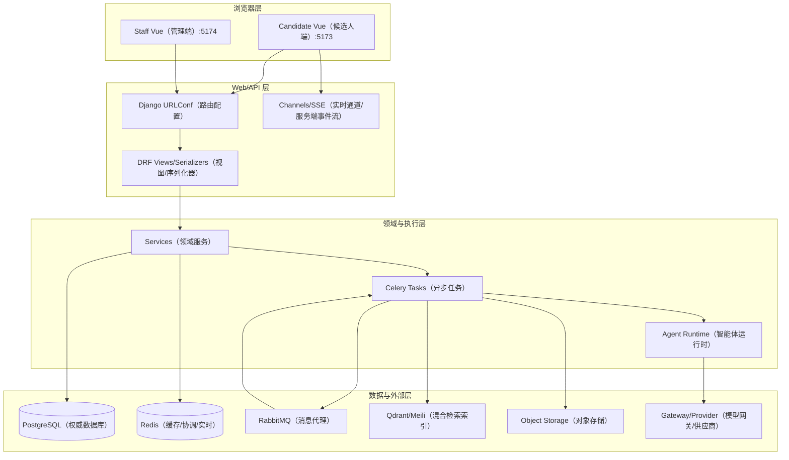

观察重点：View 不应直接承担文件解析、RAG、模型路由等长逻辑；Task 也不能绕开业务状态直接写不可追踪副作用。

面试时如何讲：用三个目录建立容器边界，再沿一个 Career GET 和一个 Resume render 说明同步/异步分层。

## 2. 前端路由与认证守卫

2026-10-07 社区视觉回归（implemented-partial，已实现/范围有限）：`/dashboard/community` 的 `CommunityHub.vue` 重新采用原 `BlogHome.vue` 的三栏阅读结构与蓝色分类样式：左侧分类、中间推荐/最新与内容列表、右侧推荐阅读/话题。`/dashboard/blog` 的旧文章页面保留不变，没有回退原生社区的审核与权限。窄屏分类横向滚动，正文单栏，不另建一套社区样式。

候选人路由在 `ai-interview-frontend/src/router/index.ts`。公开页包括 Landing、About、Login、Register、OAuth callback、公开简历分享；受保护页面位于 Dashboard layout 下。路由守卫大致执行：

1. 检查目标是否需要认证；
2. 若前端 store 尚无用户，调用 session/profile 接口恢复；
3. 未认证跳到 Login，并带 `redirect`；
4. 未完成 onboarding 跳 Onboarding；
5. 检查 route meta role；
6. 每次应用加载后检查未完成面试，弹出“继续面试/稍后处理”；
7. 决定进入目标页或未完成 Interview Room。

这段逻辑直接影响 E2E：Playwright 用 `page.goto()` 会重载整个 SPA，模块变量 `hasCheckedForUnfinishedInterview` 重新初始化，因此每个受保护路由都会再次弹恢复框。截图测试必须显式选择“稍后处理”。这不是截图工具的偶然细节，而是“应用级只检查一次”与“浏览器级每次 reload”的语义差异。

Staff 路由在独立应用中，登录状态由 `src/auth.ts` 管理。候选人 cookie/token 不能让 Staff router 进入页面；Staff 登录请求同时提交 email、password 与 TOTP/recovery code，服务端建立独立 Session。

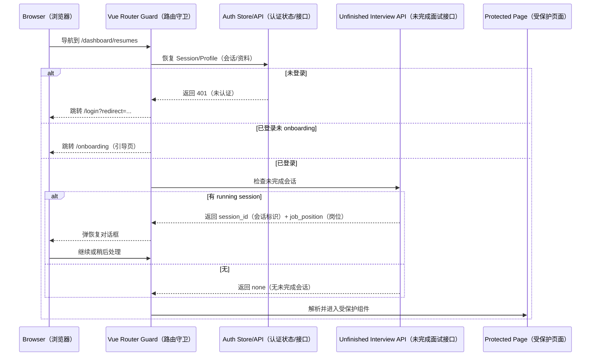

观察重点：前端守卫改善体验，但真正授权仍在后端。绕过 router 直接调用 API 必须被 owner/permission 拒绝。

面试时如何讲：区分“是否显示页面”和“是否允许访问资源”，再说明 401、403、404 的使用边界。

Resume 入口已经收敛为三条受保护路由：`/dashboard/resumes` 是简历列表，`/dashboard/resumes/:id` 是唯一 Resume Studio（简历工作室），`/dashboard/resume-templates` 是六套母版的筛选与预览页。旧生成器、旧诊断、旧预览和旧模板市场路由已经移除；侧边栏不再把用户引向两套编辑状态。模板中心通过 `resume` 查询参数把当前简历带回 Studio，不创建第二套内容模型。

## 3. Axios、Cookie、CSRF 与 API 基址

2026-10-26 合并核对：主分支的 V2 独立 baseURL（基础地址）修复与本分支归一化方案重叠，保留覆盖主机、`/api`、版本前缀的归一化器，不回退 PNG/Markdown（图片/标记文本）导出、版本参数及岗位定制接口。冲突消解不改变既有运行契约。

社区保留 V2 Feed、内容创建/提交审核，新增只读 `/api/v2/community/topics/` 客户端封装。历史社区状态与话题请求独立于主Feed，状态请求失败不再阻断原生内容；Feed失败才走已存在的兼容读取，显式显示降级。搜索/Feed使用递增请求序号，过期响应不能覆盖较新的搜索。外部链接仅允许HTTP/HTTPS，公开正文使用文本插值而非HTML执行。

候选人开发环境设置 `VITE_API_BASE_URL=/api/v1`，由 Vite 同源代理 `/api/v1` 与 `/api/v2`。这保证页面无论通过 `localhost` 还是 `127.0.0.1` 打开，CSRF 与刷新令牌 Cookie 都属于当前站点；不能把页面 host 和绝对 API host 混用，否则现代浏览器可能拦截跨站 Cookie。API 客户端配置 `withCredentials`，写请求先获取 CSRF cookie，把 `X-CSRFToken` 加入 header；响应拦截器处理 session 失效、request id 和统一错误。

路径有两种正确策略，只能选一种：

- base URL 只到 host，例如 `http://127.0.0.1:8000`，调用方传 `/api/v1/...` 或 `/api/v2/...`；
- 为 v1/v2 分别建 client，base 到 `/api/v1` 或 `/api/v2`，调用方只传域内相对路径。

Resume 模块现在使用独立的 V2 基址归一化器：配置为 host 时追加 `/api/v2`，配置到 `/api` 时追加 `/v2`，配置已经是 `/api/v1` 或 `/api/v2` 时统一替换为 `/api/v2`。业务调用只传 `resumes/...` 等域内相对路径，因此开发代理、绝对地址和生产同源三种部署不会再拼出双版本前缀。

公开页初始化时，前端先请求 CSRF token，再调用 `/auth/session/` 让服务端检查 HttpOnly refresh cookie（仅 HTTP 刷新令牌 Cookie）。Access Token（访问令牌）只保存在内存，新标签或刷新后即使内存为空，也必须尝试恢复；无 Cookie 时的 401 作为匿名结果处理，不清除一个可能有效的服务端会话。GitHub callback（回调）仍由独立回调组件完成授权码交换。真实 GitHub 用户授权需要外网账号，不纳入本地合成评估。

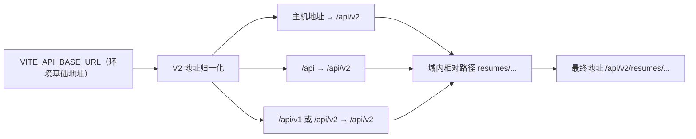

观察重点：这是已经修复的契约集成问题。测试和排障仍应断言浏览器最终 URL，不能只看源码字符串或把 404 降为空数组。

面试时如何讲：现场从 Network URL 走到 `urls.py`，解释为什么 404 被错误映射为空态，以及怎样为 v1/v2 建类型化 client 和契约测试。

## 4. Django URL 的版本边界

项目根 URLConf 聚合 authentication、domain routes、admin control plane、schema 和公开资源。v1 保留历史接口，v2 承载 Career/Resume Intelligence 等新契约。DRF router 注册 ViewSet 的标准 CRUD 和 action；显式 `path()` 注册 profile/dashboard/debug 等非资源接口。

路由设计需要满足：

- 资源名稳定，动作使用子资源或 `@action`；
- v2 不复用 v1 serializer 假装升级；
- Staff API 使用独立前缀与 authentication/permission；
- WebSocket 在 ASGI routing，不与 HTTP URL 混淆；
- SSE 是 HTTP streaming endpoint，但事件契约独立版本；
- 公开分享用随机 token，不能暴露 owner API。

`09-代码-API-数据事实索引` 自动列出现有 path/router register，OpenAPI 只能覆盖 DRF 可发现的 HTTP 接口；WebSocket、SSE 和 webhook 必须另写契约。

## 5. View、Serializer、Service、Task 各自做什么

### View/ViewSet

处理认证/权限、queryset owner scope、输入 serializer、HTTP 状态、幂等 header、事务入口和响应 serializer。以 `CareerFactViewSet` 为例，queryset 只返回当前用户；以 `CareerDashboardView` 为例，它聚合多个只读数据源。

### Serializer

做字段类型、枚举、跨字段校验和 API 投影；不能把复杂模型调用藏进 `create()` 让请求不可控。敏感字段只写或完全排除，Staff 也只拿必要投影。版本对象的 immutable 字段需要只读。

### Service

承载可复用的业务事务和领域动作。例如 `save_posting_as_target()`、`create_learning_plan()`、`record_timeline_event()` 明确输入/返回；RAG 的 `index_document()`、`search_knowledge_context()` 编排多个外部系统；Gateway service 解析 alias/route/budget。

### Task

接收稳定 ID，不接收大段可变对象；从数据库重载权威状态；claim operation；执行耗时工作；更新成功/失败；按错误类型重试。`process_resume_import_job()`、`render_resume_artifact()`、`review_resume_quality()`、`run_job_match_analysis()`、`reindex_knowledge_document()` 均属此类。

后端依赖也按运行边界隔离：`requirements.txt` 只列 Django、Agent、RAG、OCR、语音与可观测性的直接依赖，传递依赖交给解析器；RenderCV 2.8 仍由 Dockerfile 放在独立虚拟环境，避免与 Docling 的 Pydantic/Markdown 依赖互相覆盖。Windows/Python 3.12 固定使用已验证的 `Torch 2.10 + TorchVision 0.25`，PaddleOCR 固定在与当前调用接口一致的 2.10。

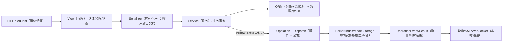

观察重点：异步任务的参数是稳定 ID；如果把完整 Resume JSON 放进消息，用户随后创建新版本时任务来源会变得不可解释。

面试时如何讲：用“View 决定能不能做，Serializer 决定输入是否有效，Service 决定业务如何提交，Task 决定耗时副作用如何恢复”概括。

## 6. 一次 Career Dashboard GET

候选人访问 `/dashboard`，`Dashboard.vue` 调用 v2 dashboard API。Django 认证中间件解析会话/令牌，`CareerDashboardView` 使用 `request.user` 查询：

- 活跃 `JobTarget`；
- confirmed `CareerFact`；
- 当前用户 `Resume`；
- `JobApplication` 状态计数；
- 未完成 `LearningTask`；
- 近期动作/事件。

返回值是一个读模型，不创建新的权威表。优势是 UI 一次请求得到一致展示；代价是查询变多，需要 `select_related/prefetch`、索引、限量和必要缓存。缓存 key 必须包含 user id、schema version；写 Career/Resume/Interview 时失效或使用短 TTL。Redis 失败时 dashboard 可回源 PostgreSQL，属于 fail-open 缓存。

截图显示目标岗位 1、职业事实 1、简历 1、补强任务 2，投递管道面试中 1。它与 fixture 和数据库一致，证明聚合主路径。

## 7. 一次写请求与事务

以“保存平台职位为 JobTarget”为例：

1. View 校验登录和目标 `JobPosting` 可见；
2. Serializer/Service 校验岗位状态；
3. `transaction.atomic()` 内创建或复用 JobTarget，保存 JD snapshot/hash；
4. `record_timeline_event()` 用 dedup key 写事件；
5. 若需分析，同事务创建 `JobMatchAnalysis`、Operation 与 `OperationDispatchOutbox`；
6. 专用 Publisher 稍后以 Confirm/Mandatory 发布 `operation_id`；
7. 返回资源和 operation id。

如果先发消息再提交事务，Worker 可能读不到记录；如果先提交后进程崩溃再发消息，会留下永远 pending。高成本命令用同事务 `OperationDispatchOutbox`，领域事实用 `IntegrationOutbox`。直接 `on_commit(send_task)` 只适合非关键唤醒，不能作为可靠投递保证。

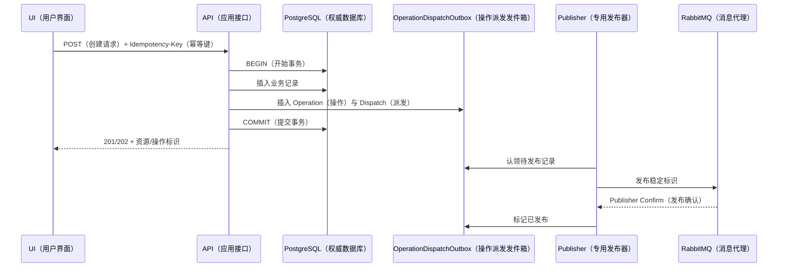

观察重点：HTTP 成功与任务完成是两个状态；前端必须区分 201 resource ready 与 202 accepted。

面试时如何讲：给出 DB commit 前、commit 后、broker ack 前后的故障窗口。

## 8. 幂等与并发

`core.IdempotencyRecord` 在 `(user, scope, key)` 上唯一。请求携带 key 时，服务端可以：

- 首次创建 processing claim；
- 同 key 同 payload 返回已有响应/operation；
- 同 key 不同 payload 返回冲突；
- processing 超时后按策略恢复；
- 保留期后清理。

`core.AsyncOperation` 是兼容类名，语义上已是平台权威 Operation：用 user/operation type/idempotency hash 关联输入、结果、lease、fencing、attempt、取消与耐久事件。异步 Header、Body、events/result URL 使用同一个 Operation UUID。业务层仍需要自己的唯一约束，例如 `ResumeVersion(resume, version_number)`、`InterviewQuestion(session, sequence)`、`CareerTimelineEvent(user, dedup_key)`、`ModelAttempt(request, attempt_number)`。

并发更新 Draft 可使用 revision/updated_at 乐观锁；会话推进用条件 update（只有当前状态/sequence 匹配才成功）；队列任务 claim 使用 `select_for_update(skip_locked)` 或原子状态更新。不要用 Redis lock 代替数据库唯一约束，锁过期或网络分区仍会产生重复。

## 9. 错误契约

API 错误至少需要 `code`、用户可理解 message、字段 errors、`request_id`、retryable。HTTP 语义建议：

- 400：格式/跨字段校验；
- 401：未登录/会话失效；
- 403：已认证但无权限；
- 404：资源不存在或为了防枚举隐藏越权对象；
- 409：版本/幂等/状态冲突；
- 413：上传过大；
- 422：可解析但业务语义不满足（若项目统一采用）；
- 429：`capacity_limited`，用户/企业配额、速率或并发槽不足；
- 503：`dependency_unavailable` 或 `async_backpressure`，协调依赖或队列背压不可用；
- 503：依赖不可用且不能降级。

前端不能把所有异常变为空数组。空集合是有效业务响应；404/503 应显示故障、request id 与重试。Resume 当前正是反例。

## 10. WebSocket：双向实时

Chat 与面试媒体/互动适合 WebSocket。握手时从 cookie/token 建立 user scope；consumer 再验证 conversation/session owner。消息协议应包含 type、client_message_id、sequence/timestamp、payload；服务端先持久化或通过 Outbox 确保消息不因连接断开丢失，再广播到 Channels group。

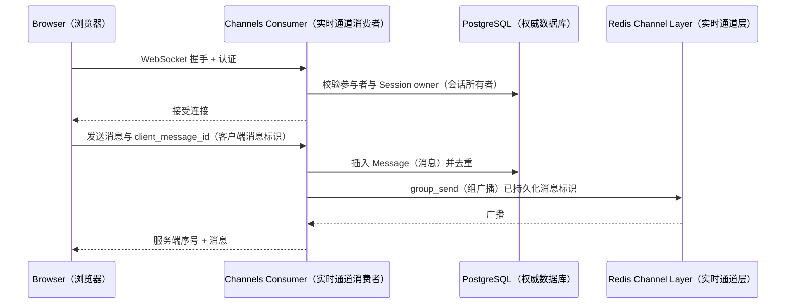

Redis Channel Layer 是分发层，不是消息权威库。断线后从 PostgreSQL 按 sequence/pagination 补消息。附件在独立上传/扫描完成前不能当安全文件广播。

## 11. SSE：单向有序 Agent 事件

SSE 使用普通 HTTP，浏览器易重连，适合 Agent 的 started/node/progress/token/question/completed/failed 等事件。每个事件需要稳定 `event_id`/sequence、run id、event type、schema version 和最小 payload。客户端传 `Last-Event-ID`；服务端从 durable event/Redis stream 找缺口。

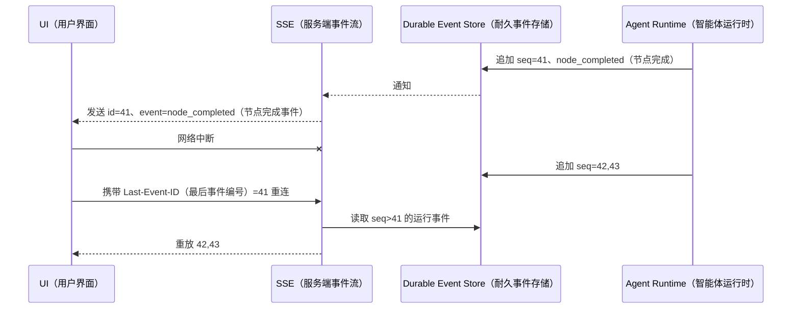

SSE 重连不能触发新的 Agent run；事件消费与命令提交必须分开。事件保留不足时返回 snapshot + new cursor，而不是悄悄缺事件。

## 12. RabbitMQ/Celery 拓扑

### 2026-10-06：队列声明不等于执行隔离

本轮启动日志定位并修复监控事件串线：Celery 保留配置 `event_exchange` 使用 `ifaceoff.celery-monitoring`，业务领域事件仍使用 `ifaceoff.events`。原来二者同名，Worker 心跳命中业务事件队列的主题绑定，消费者把非任务协议消息当作未知消息删除。两类交换机不能共用，也不能靠过滤日志解决；配置测试验证 Celery 实际加载的监控交换机与业务交换机不同。

**implemented（已实现）**：`core.worker_roles` 是本地启动脚本和基础 Compose 的队列契约。Windows 为 publisher（发布恢复）、agent（面试）、career（岗位分析）、document（文档）、resume-render（简历渲染）、resume-ai（简历智能分析）、media（媒体）、moderation（审核）、events（事件）和 auxiliary（可重建辅助任务）各启动独立进程。Windows 各进程使用 `solo（串行执行池）` 且并发数为 1，不能把 concurrency（并发配置）大于 1 解释成并行。Linux 基础 Compose 使用 prefork（多进程执行池），按角色设置并发和子进程回收上限。

新增 `ifaceoff.v2.resume.ai` 仲裁队列及死信队列，简历评审和建议不再挤占面试队列。本地启动优先使用仓库 `.venv`，显式 `IFACEOFF_PYTHON` 可覆盖。实测系统 Python 的 Celery 为 5.5.3 且缺少 Qdrant 客户端；项目环境为 Celery 5.6.3 且客户端导入正常，不能据此认为“依赖全部丢失”。

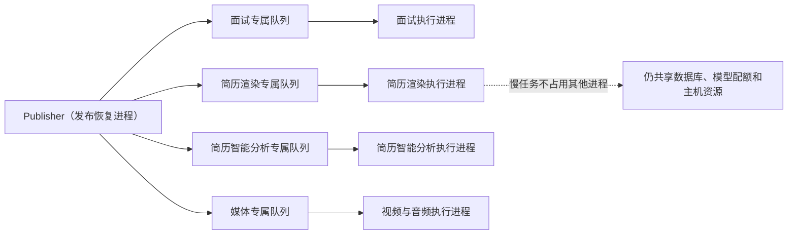

**单机运行证据**：项目环境通过真实 RabbitMQ 执行 8 秒合成渲染任务，面试、媒体、发布短任务约 62 毫秒完成。`verify_worker_isolation` 使用独立测试应用、随机临时队列和专用控制交换机，只关闭本次测试进程；不调用 AI，不消费、清空或重放业务队列。这不是业务全链路或生产性能保证。

当前代码保留三个稳定 Exchange（交换机）：`ifaceoff.commands`（命令直连）、`ifaceoff.events`（领域事件主题）和 `ifaceoff.dlx`（死信交换机）。队列名称升为 `ifaceoff.v2.*`，避免旧同名队列参数不一致导致 406：

- 关键 Quorum Queue（仲裁队列）：`agent.interactive`、`career.analysis`、`documents`、`resume.render`、`media`、`community.moderation`、`events`；
- 可重建普通持久队列：`notifications`、`search.index` 与短任务 `default`；
- 独立 `publisher` 队列负责 Operation Dispatch（异步操作派发）、Integration Outbox（集成事件发件箱）和 Agent Dispatch（智能体派发）的可靠唤醒与恢复。

代码配置包括：

- durable message/queue；
- Publisher Confirm（发布确认）与 Mandatory Routing（强制路由）；
- late/manual ACK（延迟/手工确认）；
- `task_reject_on_worker_lost`；
- prefetch multiplier 1；
- soft/hard time limit；
- delivery limit、max-length/max-bytes、`overflow=reject-publish` 与按领域 DLQ（死信队列）。

业务延迟重试只由 PostgreSQL `OperationDispatchOutbox.available_at` 调度，默认退避为 5 秒、30 秒、2 分钟、10 分钟和 30 分钟并加入抖动。仓库已经移除“只声明但没有消费者链路”的 Rabbit TTL Retry Queue（延迟重试队列）说法；RabbitMQ 只负责运输、Worker 崩溃重投和最终死信。

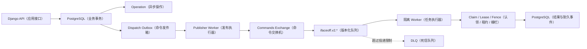

RabbitMQ 队列参数在声明后不能用相同名字改写。历史日志里的 406 来自默认 vhost（虚拟主机）旧队列缺少当前 DLX 参数；它是 Broker（消息代理）的预期保护，不是网络抖动。当前代码通过新 vhost/`ifaceoff.v2.*` 做蓝绿迁移，先 passive inventory（被动盘点）depth、unacked、consumer、binding，再 canary（小流量）验证、排空或受控 shovel（搬运），旧队列保留回滚窗口。禁止直接删除仍有 ready/unacked 消息的旧队列。

## 13. Redis 三个故障域

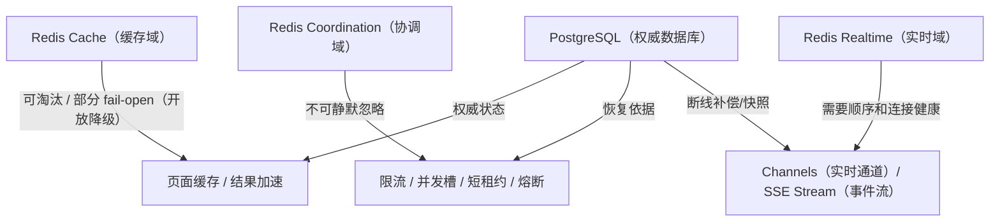

`docker-compose.infra.yml` 和生产韧性覆盖已经提供三个进程：Cache 使用 `allkeys-lfu`，Coordination/Realtime 使用 `noeviction`、AOF（追加日志）、TTL（过期时间）和容量上限。本地完整栈为兼容开发仍可用同一 Redis 的 `/1`、`/2`、`/3` 逻辑库，但不能把它描述为生产故障隔离。统一 Key Builder（键构造器）生成 `ifaceoff:<env>:<domain>:<tenant-or-global>:<resource>:v<schema>:<opaque-id>`，邮箱、IP、Token 先做 HMAC/Hash（哈希）。

Coordination 故障时登录验证码、MFA、高成本 AI 和安全写入返回 `503 dependency_unavailable`；Cache 故障绕过缓存；Realtime 故障从 `OperationEvent`（耐久操作事件）或业务快照轮询恢复。Redis lease（租约）只优化协调，最终正确性仍由 PostgreSQL fencing（栅栏）与唯一约束保证。

## 14. 上传和对象存储请求

统一上传流程应是：

1. API 校验用途、大小、扩展、声明 MIME；
2. 保存到隔离临时区，生成内部随机名；
3. ClamAV 扫描；
4. 解析器在超时/资源限制下处理；
5. 业务模型只引用通过扫描的 object key/hash；
6. 异步生成缩略图、PDF、chunk 等派生物；
7. 按隐私/业务保留期清理源文件和临时文件。

下载使用授权 endpoint 或短期签名 URL；不能把真实本地路径返回浏览器。上传日志不记录文件正文和敏感元数据。

## 15. 前后端构建与配置

候选人和 Staff 各自执行 `npm run build`。Vite 的 `VITE_*` 会进入浏览器 bundle，禁止放 secret。后端 `.env`/环境变量控制数据库、Redis、RabbitMQ、对象存储、Gateway、公共 URL 和安全 key；Secret 不进入文档或前端。

生产配置必须校验 `DEBUG=False`、ALLOWED_HOSTS、CORS/CSRF origin、Secure/HttpOnly/SameSite cookie、HTTPS、对象存储和加密 key。`SECRET_KEY`、TOTP encryption、Provider 密钥轮换需要独立管理。

## 16. 测试这条全栈链

社区 `scripts/community_browser_check.js` 使用 Playwright CLI（浏览器自动化入口）读取当前真实Vue页面，API全部为明确合成响应；分类、话题、公开正文阅读3项检查通过，1440×900与390×844截图已目视检查。早期过宽API拦截误拦截Vite源码模块导致空页，已收紧到`/api/v1|v2/`路径；这是测试装置问题，不伪称后端故障。移动社区宽约375px且单栏，无正文横向撑开。推荐阅读来自已加载Feed而非热度统计，分类/最新排序仅作用于当前加载列表，不声称全量检索或完整分页。生产构建通过，仍有原有大包与浏览器数据版本警告。

统一确定性评估入口支持离线 SQLite、隔离 PostgreSQL/Redis/RabbitMQ、真实浏览器以及本机只读 HTTP 压测。`platform` 组覆盖认证、简历确定性流程、Career、Community、Chat 与 Staff API；报告将浏览器集成、HTTP QPS、业务 TPS 分开记录。APIClient 单进程采样不是 HTTP 延迟；健康端点 QPS 也不代表业务 TPS 或生产容量。

已自动覆盖 Operation（异步操作）同事务创建、24/100 并发幂等、lease/fencing、cancel/complete 竞态、Dispatch payload 仅 Operation ID、Inbox 活跃租约、Redis Lua 原子桶、Staff first-claim（首次认领）、Gateway Closed/Open/Half-open（关闭/打开/半开熔断）、Resume/Career/Knowledge/Media/Community/Agent 接入和跨用户 404。

Celery eager（进程内急切执行）或 memory broker（内存代理）不能代替真实 RabbitMQ。当前 Docker daemon（容器守护进程）不可用，因此以下仍为 `pending-verification（待验证）`：三节点 Quorum 节点故障、Publisher Confirm NACK/timeout、Broker 停机后恢复、Worker 在提交/ACK 前后被杀、真实 DLQ 受控重放、PostgreSQL Checkpoint crash/restart、500 在线用户和 100 个高成本并发任务。

2026-08-21 的 Resume/语音增量验证新增 47 个聚焦用例，覆盖 V2 URL、六套模板元数据、PNG/Markdown 制品、岗位 Variant（变体）、ATS 与 AI 评审分层、语音延迟指标、流式 TTS 账本和浏览器/后端转写去重契约；Candidate Vue 生产构建通过。真实浏览器 Studio 操作、Typst/PNG 黄金像素、收费 ASR/TTS 供应商与弱网延迟仍是 `pending-verification（待验证）`，不能由编译和 Mock（模拟）测试外推。

同日的本地运行复验在全新 `.venv` 中完成：`pip check` 无冲突，Django 普通检查与迁移漂移检查通过，24 个 Operation 聚焦测试通过；主库迁移、Agent Checkpoint、V2 RabbitMQ 拓扑、合并开发 Worker、Beat、Candidate 与 Staff Vite 服务均实际启动。`/api/v1/system/readiness/` 与 Agent `/health` 返回 200；同源 CSRF 探针得到 Cookie，写请求进入正常 400 参数校验而非 403。该证据是单机开发验证，不代表三节点 RabbitMQ 或生产 TLS/ACL 已验收。

同日第二轮日志驱动回归修复了 Resume Studio 的 PostgreSQL 可空关联锁、RenderCV 本地手机号与 Windows UTF-8 输出、Agent Dispatch 可空 Operation 投影、GitHub 登录页无令牌 401、录像合并缺少幂等键以及 Qdrant 客户端/服务端接口漂移。85 个 Knowledge/Resume/Career/Agent/GitHub 聚焦测试通过（2 个显式跳过），Candidate 生产构建通过；真实 Resume 31/35/36 预览 Operation 均完成，Agent Dispatch/Execution/Operation 均进入成功终态。GitHub 供应商最终同意授权、三节点 MQ 与收费语音延迟仍分别属于用户交互或 `pending-verification（待验证）`。

关键 E2E 断言不只找 heading，还应：

- 截获 API response 并断言 status/schema；
- 页面显示 fixture 的稳定业务标识；
- 数据库/接口最终状态一致；
- 失败态不伪装成空态；
- 重新加载后可恢复；
- Staff 无权限看不到/调不了操作。

2026-10-06 的浏览器复测发现并修复两项真实前端缺陷：新标签因内存 Token 为空跳过 Cookie 会话恢复；Studio 把 Vue 响应式对象直接传给 `structuredClone`，导致 PATCH 前克隆失败。Studio 现在发送 JSON 快照，并在请求途中继续编辑时保留新值、排队再保存；版本/头像等依赖最新草稿的动作先等待保存成功。定向浏览器测试会在第一次 PATCH 延迟期间继续输入，核对最后一稿，并记录最后编辑到保存状态显示的单次耗时；单样本不是 p95。

## 17. 30 秒口述卡

“候选人请求从 Vue Router 和 Axios 进入 Django v1/v2 URL，DRF View 做权限，Serializer 做契约，Service 做事务，PostgreSQL 保存权威状态；耗时任务在同事务写 operation/outbox 后由 RabbitMQ/Celery 执行，WebSocket 负责双向实时，SSE 负责 Agent 有序事件和断线续传。Redis 的缓存、协调、实时用途分开，索引和对象存储都是可重建投影。”

## 18. 2 分钟口述卡

选择 Career Dashboard 讲同步 GET，再选 Resume Artifact 讲 202 + Celery，再选 Interview 下一题讲 Execution/checkpoint/SSE。补充 cookie/CSRF、owner permission、幂等、Outbox、唯一约束和错误契约。最后展示 Resume `/api/v1/api/v2` 缺陷和 RabbitMQ 406，说明自己如何从页面、Network、Django 日志和 Broker 声明定位。

## 19. 连续追问

**为什么 `on_commit(send_task)` 还不够？**<br>
它避免 Worker 在事务提交前读取，但提交后、send 前进程宕机仍丢任务；Outbox 把待发布事件纳入同一事务。

**SSE 和 WebSocket 怎么选？**<br>
服务器单向、有序、可用 HTTP 重连的 Agent 进度选 SSE；需要客户端持续发送音频/聊天的双向通道选 WebSocket。两者权威状态都不在连接本身。

**缓存击穿怎么办？**<br>
短 TTL 加 jitter、请求合并/协调锁、只缓存 bounded read model、数据库索引和限流；锁失败时不应让所有请求无限等待。

**如何避免 v1/v2 路径再出错？**<br>
每版本独立 Axios client 或 host-only client，禁止字符串混用；用 OpenAPI 生成类型 client；E2E 断言请求 URL 和 2xx；404 不转换为空列表。

**队列参数变更怎么上线？**<br>
不能热改同名队列。用版本化 queue/vhost 或停机排空迁移，检查未确认消息和消费者，再删除重建；上线前做 passive declaration/拓扑测试。

## 20. 调试实录：怎样把“页面没数据”定位到一行 URL

下面不是抽象排障套路，而是本次文档采集时真实出现的链路。独立 PostgreSQL 已经通过
`seed_documentation_demo` 创建了 Resume、ResumeVersion 和 ResumeDraft，Django Admin 也能查到；
候选人登录成功，Career 页面能够显示合成数据，但 Resume 列表仍显示 0。这个现象首先排除了“整
个数据库未连接”和“登录态彻底失效”，却不能直接排除 owner filter、Serializer 或 API 版本错误。

浏览器 Network 给出的关键证据是请求实际发往 `/api/v1/api/v2/resumes/`。前端 Axios 实例已经把
`/api/v1` 作为 baseURL，而 Resume 页面又传入绝对业务前缀 `/api/v2/resumes/`，客户端拼接后形成
一个后端没有注册的混合版本路径。Django 返回 404，页面的数据适配层把失败结果折叠成了空列表，
于是“接口寻址错误”在 UI 上看起来像“用户还没有简历”。这类缺陷危险之处不是 404 本身，而是
错误语义被空态吞掉：开发者会反复检查 seed、权限和数据库，却看不到真正的路径。

一条可复用的诊断顺序如下：

1. 在页面确认登录态和可复现操作，记录路由、用户角色与时间。
2. 在 Network 中查看**最终 URL**，不要只看源码里传给 Axios 的字符串。
3. 对照 Django 根 `urls.py`、应用 `urls.py` 和 DRF router，确认版本前缀只出现一次。
4. 用同一 Cookie/CSRF 上下文直接调用正确 URL，区分寻址问题与权限问题。
5. 在 PostgreSQL 用 owner 条件查询，确认权威记录是否存在。
6. 查看 Django access log 的状态码；404、401、403、409、422、500 的排查方向不同。
7. 最后才检查页面的数据映射和空态组件，避免先改 UI 掩盖后端错误。

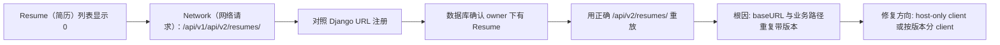

观察重点：排障证据从用户可见结果逐层向下收敛，任何一层都不能由“目录里看起来有代码”替代。

面试时如何讲：不要回答“我看日志修了一个 404”。应讲清楚如何通过对照组排除数据库、身份和
owner filter，为什么错误折叠为空态会延长 MTTR，以及你会用生成 client 与 E2E URL 断言防复发。

本轮知识库只记录此缺陷为 `current-partial`，没有借文档重构修改业务行为。这样截图仍是当前真实
页面，而不是为了让教材好看临时改成 Mock 数据。

## 21. 四类请求的逐层执行剖面

### 21.1 同步只读：Career Dashboard

浏览器进入 Career 工作台后，Vue Router 先执行认证守卫；Axios 携带会话 Cookie，并在需要时附带
CSRF header。Django URL 把请求交给 `CareerProfileView` 或对应只读 `ViewSet`。`OwnedReadOnlyViewSet`
的价值是把 `request.user` 约束放在查询入口，而不是先查任意对象再由前端隐藏。Serializer 把模型
和嵌套展示字段变成稳定响应；PostgreSQL 是权威源，Redis 只能缓存有明确 owner/tenant 维度的读
模型。一次成功响应不产生后台任务，也不应该为了“统一”强行走消息队列。

如果页面要同时展示 Fact、Target、Application、AbilitySnapshot 和 LearningTask，最直接的五次
HTTP 调用会制造瀑布。可选方案有后端聚合端点、并行请求或缓存 dashboard projection。当前实现
保留多个领域端点，面试中应说成“现有边界”，不能声称已经有完整 BFF。扩容时要先用浏览器 waterfall
和数据库 query count 证明瓶颈，再决定是否新增聚合接口；否则聚合接口很容易变成无法缓存、无法
独立授权的大查询。

### 21.2 同步写入：创建 Career Fact

`CareerFactSerializer` 负责字段类型、枚举和长度验证，ViewSet 负责把 owner 固定为当前用户。
业务写入若还要追加 `CareerTimelineEvent`，两者应在 `transaction.atomic()` 中完成；如果时间线由
事件消费者投影，则主事务写 Fact 与 Outbox，消费者幂等生成 Timeline。两种方案的产品语义不同：
强一致方案保证响应成功时立即可见，事件投影方案允许短暂延迟但解耦更多下游。

客户端重复提交不能仅靠按钮 disabled。网络超时后用户重试时，服务端要依据 idempotency key、
自然业务键或唯一约束返回原结果。若一个事实允许多个来源和历史版本，不能粗暴用
`(user, fact_type)` 唯一；应把语义相同的请求 hash 与业务修订概念分开。冲突响应使用 409，并返回
当前版本/ETag，页面才能提示刷新或合并。

### 21.3 接受即异步：Resume Artifact

PDF/DOCX 渲染可能调用 RenderCV、Typst、字体和对象存储，不适合占用 Web worker 等待。API 在事务
中创建 `ResumeArtifact`，其输入固定为 ResumeVersion、ResumeDesignRevision、格式和
`artifact_cache_key()`；提交后发布 Celery 任务，响应返回 202 和 operation/artifact id。前端轮询
或订阅状态，而不是假装文件已生成。

Worker 调用 `render_artifact()` 时必须把状态推进与外部副作用分开考虑。对象已写但数据库未标记
ready 时，重试应复用稳定对象 key 或先验证对象 hash；数据库已 ready 但响应丢失时，客户端再查
同一个 Artifact。只有输入 hash、唯一 cache key 和状态条件更新同时存在，重复投递才不会造成多
份不可追踪制品。

### 21.4 长运行实时：Agent 下一题

回答文本先写 InterviewQuestion/Answer 相关权威记录，再由 `create_answer_execution()` 创建
`InterviewAgentExecution`、generation job 与 `InterviewAgentDispatch`。Web 请求不用持有数据库锁
等待模型；Worker 通过 `run_interview_execution` 获取执行权，V4 图节点写 checkpoint 与
AgentEvent；SSE 只传输已排序的事件。浏览器断线后带 last sequence 重连，服务端先补 durable event，
再继续推送 live event。

这里的“实时”不是把模型 token 直接从 Worker 内存扔给浏览器。若连接、Web 进程或 Redis 中断，
权威 `Execution.status`、`last_durable_sequence` 和最终 question 仍可恢复。实时层可以降级为轮询；
业务执行不能依赖某条 TCP 连接一直存在。

## 22. 事务边界清单：哪些事绝不能放在同一个锁里

| 场景 | 事务内必须完成 | 事务外完成 | 故障后的判断依据 |
|---|---|---|---|
| 保存 Career Fact | owner、字段、版本/时间线或 Outbox | 搜索投影、统计 | PostgreSQL Fact 与事件 id |
| 创建 Resume Version | version number、content hash、基线关联 | 质量分析、渲染 | 唯一约束与 content hash |
| 提交面试回答 | 回答、Execution、Dispatch | 模型评估、下一题 | request hash 与 execution id |
| 上传知识文档 | ImportBatch/File 元数据、隔离状态 | 解压、OCR、切块、Embedding | batch status 与文件 hash |
| 模型调用 | Budget reservation、Ledger pending | Provider HTTP 调用 | ledger id、attempt、reservation |

外部 HTTP、模型调用、FFmpeg、ClamAV 和大文件 I/O 都不应在持有业务行锁时执行。否则一个慢服务
会把数据库并发退化为串行，并导致锁超时与级联重试。正确做法是：事务内固化输入和执行意图，
事务外做不可控工作，再以 compare-and-set 或唯一键提交结果。锁保护的是“谁有权推进状态”，不是
保护整个耗时过程。

以预算为例，先锁定 `UsageBudget` 并预留估算额度，立即提交；Provider 返回后按真实 token 结算。
如果 Provider 超时，reservation 进入可回收状态，由 reconciliation 确认是否有 Attempt 账单再
释放。把 Provider 调用放在预算行锁里会让同租户所有模型请求排队，也无法避免网络结果未知。

## 23. 错误语义与页面体验对照表

| 后端结果 | 代表含义 | 页面应该怎样表现 | 不应做什么 |
|---|---|---|---|
| 400/422 | 请求结构或字段不合法 | 定位到字段，保留用户输入 | 转成“服务器繁忙” |
| 401 | 身份过期或未登录 | 清理无效态并跳转登录 | 显示空列表 |
| 403 | 已认证但无权限/MFA不足 | 告知权限边界，可引导 step-up | 自动重试 |
| 404 | 资源不存在或 owner filter 隐藏 | 区分页面失效和集合 URL 配错 | 对所有接口返回空态 |
| 409 | 幂等 hash、版本或状态冲突 | 展示当前版本，允许刷新/rebase | 覆盖服务端数据 |
| 429 | 限流、预算或准入拒绝 | 显示 retry-after/额度原因 | 立即无限重试 |
| 502/503 | 依赖或服务暂不可用 | 降级、轮询或稍后恢复 | 把 partial 说成 completed |

错误契约至少应有 `code`、用户安全 message、field details、request id 和可选 retry metadata。错误
code 是前端分支和监控聚合的稳定键，message 允许本地化；不能让页面依赖 Python exception 文本。
对于隐私敏感资源，404 可以有意隐藏其是否存在，但服务端审计仍应记录真实拒绝原因。

## 24. 从小规模到生产的演进顺序

当前组合适合在一个 Compose 环境展示完整边界，但“组件都启动”不等于生产就绪。演进应按证据而
不是按组件清单推进：

第一阶段先把契约变得可观测：统一 request id、operation id、execution id 和 ledger id；建立
成功率、P95、队列等待、索引延迟与预算偏差指标。没有这些数据，增加缓存和拆服务只会把问题藏
得更深。

第二阶段消除已知单点错误语义：统一 API client 版本策略，修复错误吞空态；为 RabbitMQ topology
增加版本化迁移和 passive startup check；把 readiness 与 liveness 分开。此阶段的收益通常大于
立即上 Kubernetes。

第三阶段根据热点做边界扩容：Web、Celery 队列与媒体 Worker 可独立扩；只读 dashboard 可加投影；
Qdrant/Meili 索引器按 revision 分片；对象存储从本地兼容层迁到具备生命周期策略的服务。任何拆分
都保留 PostgreSQL event/outbox 作为重放依据。

第四阶段才讨论多可用区、Broker/Redis/PostgreSQL 高可用、WAF 与灾备演练。高可用不是把每个组件
复制三份，还必须验证客户端超时、DNS、连接池、fencing、备份可恢复和运维权限。面试时给出这个
顺序，比罗列云产品更能说明工程判断。

## 25. 精讲：一个异步 Operation 如何从 202 走到终态

### 25.1 先给三十秒回答

高成本请求不会由 API 直接 `.delay()` 后就返回“成功”。iFaceoff 先在同一个 PostgreSQL 事务中固化领域输入、`AsyncOperation` 和 `OperationDispatchOutbox`；事务提交后，专用 Publisher（发布器）把只含 `operation_id` 的命令送入版本化 RabbitMQ 队列。Worker（任务进程）从数据库认领 Operation，获得 lease（租约）与 fencing token（栅栏令牌），再执行模型、OCR、渲染或媒体处理。结果与 `OperationEvent` 同事务写回，前端用同一个 Operation UUID 查询详情和增量事件。RabbitMQ 保证运输的“至少一次”，PostgreSQL 状态机和业务唯一约束保证重复消息不会重复产生业务结果。

这段回答刻意没有说“消息队列保证任务恰好执行一次”。Celery late ACK（延迟确认）、网络重连和 Worker 崩溃都会造成重复投递；系统能承诺的是**同一业务意图有稳定身份，旧执行权不能覆盖新状态，重复执行可被识别或复用**。

### 25.2 为什么不能直接 `transaction.on_commit(task.delay)`

先构造两个时间窗口：

1. 如果在数据库提交前发送任务，Worker 可能先查数据库，看不到尚未提交的输入；随后它失败，而 API 事务却成功，系统留下“有业务记录、无可靠结果”的组合。
2. 如果只在 `on_commit()` 回调里发送，确实避开了“读未提交”，但数据库提交后、回调真正发消息前，Web 进程仍可能退出。业务已经成功，发送意图却只存在于进程内存，重启后无法恢复。

Outbox 的关键不是“异步”两个字，而是把**业务事实和发送意图放入同一原子提交**。`transaction.on_commit()` 在当前实现中只负责尽快唤醒 Publisher；即使唤醒失败，数据库里的 Dispatch 仍可被周期任务重新扫描。因此回调是延迟优化，不是可靠性根基。

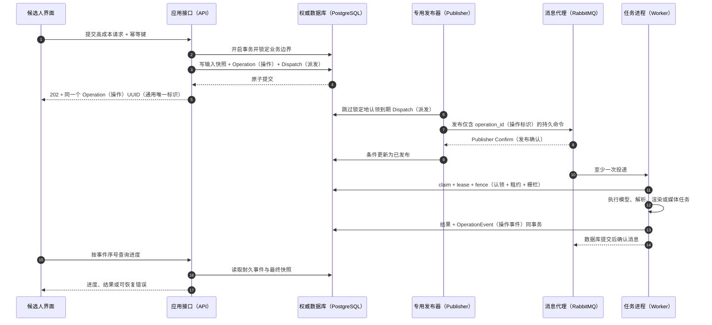

### 25.3 按源码顺序走一遍

以 Resume 质量评审或 Career 岗位分析为例，领域 View 先校验 owner、输入版本和 `Idempotency-Key`，再在外层事务创建不可变输入快照。随后调用 `core/operations.py:create_operation_with_dispatch()`：

1. `create_operation()` 写入 operation type、输入引用/hash、最大尝试数和 correlation/trace id，并追加 `operation.accepted` 事件。
2. `create_operation_with_dispatch()` 使用 `settings.CELERY_DEFAULT_QUEUE` 或领域显式队列，创建 Payload 被模型强制收敛为 `{"operation_id": "..."}` 的 Dispatch。简历正文、JD、回答、Prompt 和密钥不会进入 Broker。
3. `_kick_dispatch_publisher_on_commit()` 尝试把 Publisher 调度到 `ifaceoff.v2.publisher`。异常被吞掉是有意的：PostgreSQL Dispatch 才是待发送事实，Beat/Recovery 会再次扫描。
4. `core/tasks.py:publish_operation_dispatch_outbox()` 用 `select_for_update(skip_locked=True)` 认领到期记录，调用 `apply_async(..., mandatory=True)`。全局 `confirm_publish=True` 让连接等待 Broker 确认；不可路由或确认失败时，Dispatch 回到 `failed` 并设置下一可用时间，超过发布上限才进入数据库 `dead`。
5. `execute_operation(operation_id)` 不接受数据库里的任意 task path，而是通过 `operation_registry.py` 的静态 allowlist 找到处理器。这样篡改 Dispatch 记录也不能让 Worker import/执行任意函数。
6. `claim_operation()` 在行锁内检查终态、取消、下一尝试时间和活动租约；成功后增加 `attempt_count` 与 `fencing_token`，写 owner、lease expiry 和 heartbeat。达到 `max_attempts` 时直接进入失败终态，避免越过数据库约束。
7. 处理器通过 `OperationExecutionContext` 重载数据库输入，可调用 heartbeat/checkpoint，并在耗时步骤之间检查取消。连接超时等暂时错误映射为 `retrying`，参数/权限/损坏输入映射为 `failed`；重试会追加新的 Dispatch generation（派发代际），而不是改写历史投递。
8. `complete_operation()` 再次校验 owner、未过期 lease 和 fencing token，然后把结果引用、脱敏摘要、100% 进度和 `operation.succeeded` 事件放在同一事务。旧 Worker 即使晚到，也会因 token 不匹配得到 `OperationLeaseLost`，不能覆盖新执行者。

这八步分别对应“接收意图、可靠运输、执行排他、业务提交”四个不同问题。把它们压成一个 `task.status` 字段，既解释不了消息在哪里丢失，也无法判断哪个 Worker 仍有提交权。

### 25.4 状态不是装饰：取消与重试怎样竞争

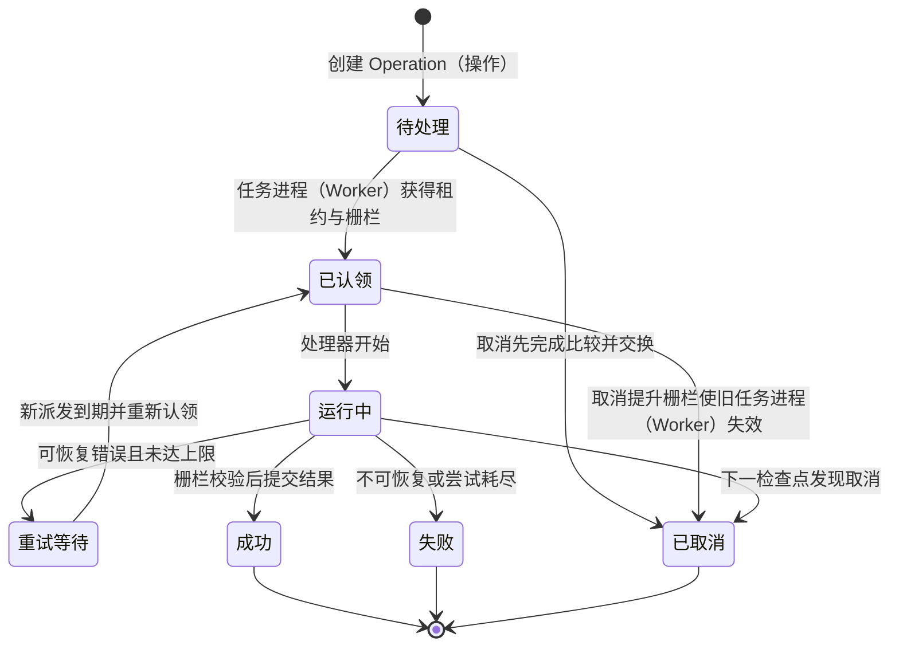

如果 Worker 的成功事务先获得行锁并提交，Operation 已是终态，后到取消返回状态冲突；如果取消先锁定并提升 fencing token，旧 Worker 的 `complete_operation()` 必须失败。系统没有“看运气决定谁赢”，而是用行锁、状态条件和栅栏令牌给竞态一个确定顺序。

人工重试同样不是把失败记录改回 `pending` 就结束。`request_operation_retry()` 先确认当前确为可重试失败，再清理终态字段、提升状态版本并追加新 Dispatch。历史派发不删除，因此 Staff 能看到每一代为什么失败、什么时候重发；同一个幂等请求也不会悄悄创建另一条无关 Operation。

### 25.5 七个故障窗口逐一推演

| 故障发生点 | 数据库里能看到什么 | 系统下一步 | 防重复/防误报机制 |
|---|---|---|---|
| 输入、Operation、Dispatch 事务回滚 | 三者都不存在 | API 返回失败，可安全重试 | 同一事务，不出现孤儿 Operation |
| 数据库已提交，Broker 宕机 | Operation pending，Dispatch pending/failed | Publisher 退避并在 Broker 恢复后重发 | API 只能说 accepted，不能说 completed |
| Broker 已确认，Publisher 写 published 前崩溃 | Dispatch 可能仍 publishing/failed | stale reclaim 后重复发布 | Worker claim/fence 与业务唯一键 |
| 同一消息投递两次 | 一个活动 lease 或已经终态 | 第二个 Worker claim 得到空并按幂等重放返回 | 行锁 + 活动租约 + 终态检查 |
| Worker 外部调用完成、结果事务前崩溃 | Operation 仍 running，外部结果可能存在 | lease 过期后新 Worker重试并按稳定结果键复用 | Operation ID、内容 hash、领域唯一约束 |
| 旧 Worker 停顿，新 Worker 已恢复 | 新 Worker 持有更高 fencing token | 旧 Worker 的 checkpoint/complete 被拒绝 | PostgreSQL fence，而非仅 Redis 锁 |
| Realtime Redis 或浏览器连接中断 | Operation 与耐久事件仍在 PostgreSQL | 客户端按 `after_sequence` 轮询补齐 | `OperationEvent(operation, sequence)` 唯一 |

其中最容易被忽略的是“外部调用已成功、数据库未知”。对于 Artifact（制品）要使用稳定对象 key 和文件 hash；对于报告、题目、积分、通知要有领域唯一键；对于模型请求要保留 Request/Attempt（请求/尝试）账本。Operation 状态机能拒绝过期提交，但不能凭空撤销第三方已经发生的副作用。

### 25.6 怎样验证，以及每条证据没有证明什么

```powershell
cd ai_interview_backend
python manage.py test core.test_operations --settings=ai_interview_backend.test_settings --noinput -v 2
python manage.py check
python manage.py makemigrations --check --dry-run
```

`core.test_operations` 覆盖同源多 Operation、Payload 仅含 ID、队列 routing key、claim/heartbeat/complete 栅栏、attempt 上限、取消竞态、派发代际、stale recovery、并发 Worker、事件游标、重试权限和幂等指纹。它能证明数据库协议在测试环境中的确定性，不能证明真实 RabbitMQ Publisher Confirm、三节点 Quorum leader 故障或 500 用户容量。

Compose `config` 能证明 YAML 合并和环境变量解析，不证明容器健康；单节点 RabbitMQ 能验证队列参数和重投语义，不证明高可用；只有在隔离 vhost 做 passive topology check、真实 publish/consume、Worker 崩溃注入和三节点故障演练，才能把相关条目从 `pending-verification` 提升为运行证据。

### 25.7 什么时候不要用这条链

普通只读 API、可在一个短事务内完成的低成本写入、无副作用且可立即返回的确定性计算，不应为了“架构统一”全部创建 Operation。异步协议带来额外表、状态、清理、监控和用户等待成本。只有当任务明显超过 Web deadline、依赖不稳定外部服务、需要取消/进度/重试，或重复执行会产生显著副作用时，这套链路才值回复杂度。

面试时可以这样收束：“我没有把 RabbitMQ 当业务数据库，也没有把 Celery late ACK 说成恰好一次。数据库事务保存输入和派发意图，Broker 至少一次运输，Worker 用 lease/fence 抢执行权，领域唯一键处理外部副作用，事件序列支持断线恢复。当前数据库并发协议已有测试，真实 Broker、多节点与容量仍按待验证口径说明。”
