# 卷六：平台工程、可靠性、安全与运维

## 1. 平台卷解决什么

Career、Resume、Interview、Agent 解释了用户主链，但一个可长期维护的平台还需要：

- 身份、Session、OAuth、隐私和通知偏好；
- 独立 Staff 控制面与高风险访问；
- Community/Blog/Chat/Notifications 的内容与实时治理；
- 幂等、AsyncOperation、Outbox/Inbox、运行策略和限流；
- PostgreSQL、Redis、RabbitMQ、Celery、索引、对象存储和观测；
- 上传安全、Secret、审计、备份、故障响应和测试。

这些能力不是“基础设施附件”。例如一次 Resume 导出若没有 AsyncOperation、队列、对象安全和清理，就无法真正向用户交付；一次 Staff Agent 配置若没有 MFA 和审计，就会成为全平台 Prompt/模型密钥的高风险入口。

## 2. Candidate Identity

自定义 User 模型保存 email/username、基础资料、headline/location/availability、onboarding 状态等。迁移 `users.0005` 使用 `UniqueConstraint(Lower('email'))` 之类的数据库约束保证 email 大小写不重复，不能只在 serializer 中 `lower()`。

候选人认证涉及：

- CSRF cookie 获取；
- email/password 登录与 Session/令牌；
- profile/session 恢复；
- refresh/logout/blacklist；
- GitHub OAuth flow/callback；
- 隐私导出/删除请求；
- 通知偏好。

OAuth 用 `OAuthFlow` 保存 state/nonce/redirect/过期，回调校验后绑定 SocialAccount。不要把 GitHub access token返回浏览器或长期明文保存。OAuth 账号 email 与本地账号合并需要已验证 email 和显式策略，防账号接管。

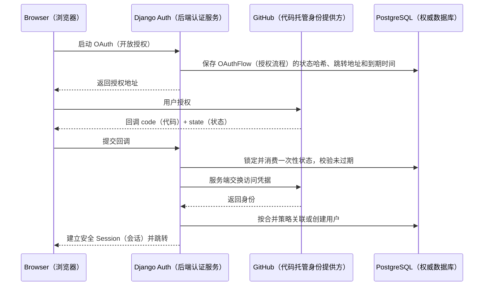

观察重点：state 是一次性数据库记录，token exchange 在后端；redirect 受白名单约束。

面试时如何讲：解释 OAuth 防 CSRF、账号合并和 token 最小化，而不是只说用了 allauth。

## 3. Staff 独立认证、MFA 与 RBAC

2026-10-07 增补（implemented-partial，已实现、验收范围有限）：`GET /api/admin/v1/operations/broker-dlq/?queue=...` 需要 `platform_events.view`；同路径 POST 的试运行与重放还需要 `platform_events.replay`。Staff Cookie 认证原有 CSRF 约束不变，APIClient（接口测试客户端）的身份注入不等同于真实登录/MFA 验收。

Staff 不是 `User.role=admin`。`staff_admin` 有 `StaffAccount`、角色/权限、Session/邀请/恢复、MFA/Recovery、审计、Break Glass、Feature Flag 等模型和接口。前端也在 `ai-interview-admin/` 独立构建。

登录页明确“候选人账号无法登录此管理端”，要求员工邮箱、密码、MFA 动态口令或恢复码。MFA secret 加密保存；恢复码只存 hash，使用后作废；高风险操作可要求 recent MFA。

RBAC 使用权限代码而不是页面名。例如知识审批、Agent 配置发布、Gateway 凭据、隐私访问、Staff 管理各是不同 permission。角色只是权限集合。后端每个 action 检查权限，前端菜单隐藏不是安全控制。

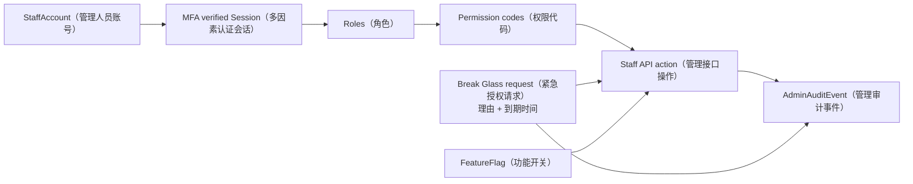

观察重点：普通操作与 Break Glass 最终都进入审计；Feature Flag 只能控制暴露，不能绕过 permission。

面试时如何讲：用 Support 查看候选人隐私的例子说明最小权限、二次验证、理由、限时和复核。

## 4. 审计与防篡改

真实 Broker DLQ（消息代理死信队列）操作记录 `broker_dlq.replay_started/publish_confirmed/replay_finished/replay_failed`。开始审计先于消费，逐条发布确认审计先于原消息 ACK（消费确认）；审计失败时原消息不确认。只保存消息正文哈希、路由和计数，不保存简历、参数正文、Provider（供应商）凭据或连接异常详情。确认后、原消息确认前崩溃仍可能重投，审计不是跨 PostgreSQL/RabbitMQ 的原子事务。

`AdminAuditEvent` 记录 actor、action、target、request id、原因、前后摘要、IP/UA hash、时间，并有 event_hash/previous hash 类字段形成链式证据。哈希链能发现离线修改，但不能阻止拥有数据库权限的人重算整条链；生产要将摘要/锚点外送到只追加存储或 SIEM，并限制表权限。

审计不应保存密码、TOTP、Provider secret、完整 Resume/回答。对大对象保存字段级 diff/hash 和安全摘要。审计查询本身也要授权与记录。

## 5. Break Glass

高风险访问流程：

1. Staff 有基础 permission；
2. 提交目标、operation reason、工单/事故号；
3. recent MFA；
4. 服务端签发短期 grant，只限 target/scope；
5. 每次访问验证 grant 未过期/未撤销；
6. 记录审计并通知安全/复核人；
7. 到期自动失效。

不能以一个长期 `is_superuser` 替代。生产目标可增加双人审批，但当前是否完整实现需以 Staff 模型/action 测试为准。

## 6. Core Platform：幂等与异步操作

### 2026-10-06：背压作用于真实瓶颈

**implemented（已实现）**：高成本准入不再全局统计 IntegrationOutbox（领域事件发件箱）。统一契约将业务 scope（范围）映射到命令队列，只统计该队列待处理/待重试操作的到期派发，计入已发布未认领命令并按 Operation 去重，避免重投代次虚增计数。简历积压不能拒绝面试或媒体；Redis 用户/IP/企业原子令牌桶和协调域故障关闭策略保留。

阈值仍沿用运行策略 `outbox_max_backlog/outbox_max_age_seconds`，但含义为所选命令队列。数据库反映权威操作等待，不替代真实 RabbitMQ ready/unacked（待取/未确认）指标，也不证明主机没有资源竞争。

`core.AsyncOperation` 原表已经就地演进为平台权威 Operation；为保持数据库表名和旧外键兼容，Python 类名本轮仍保留 `AsyncOperation`。它覆盖 `pending`、`claimed`、`running`、`retrying`、`review_required`、`cancel_requested`、`succeeded`、`failed`、`canceled`，并保存输入引用与哈希、结果引用与脱敏摘要、幂等键哈希、attempt 上限、下一次执行时间、lease owner/expiry/heartbeat、fencing token、状态版本、取消时间、correlation/trace、事件序号及开始/完成时间。

数据库约束保证：`claimed/running` 必须有有效 lease 字段，终态必须有 `completed_at`，attempt 不超过上限，进度不超过 100。所有状态变化只能经过 `create_operation_with_dispatch`、`claim_operation`、`heartbeat_operation`、`complete_operation`、`fail_operation`、`request_operation_cancel` 和 stale recovery 服务，Worker 与管理端不得直接更新状态。`IdempotencyRecord` 可关联同一个 Operation，异步响应的 Header、Body、events URL 和 result URL 使用同一个 UUID；同步请求不再伪造 Operation ID。

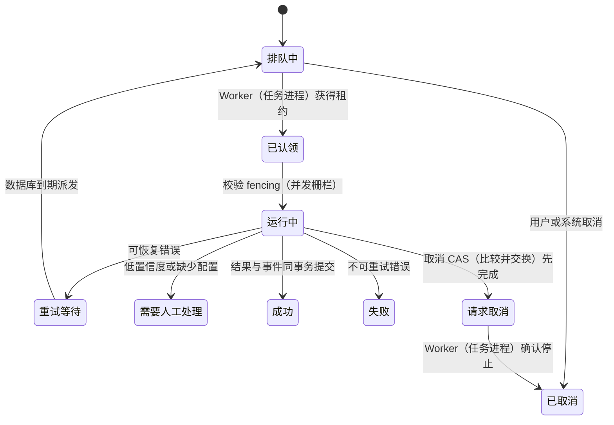

取消与完成采用确定性竞态：成功事务先提交时，后到取消返回终态冲突；取消 CAS 先成功时立即提高 fencing token，旧 Worker 的完成写入会被拒绝。lease 过期后新 Worker 获得更高 token，旧 Worker 即使稍后返回也不能覆盖新状态。前端任务中心聚合 Operation 和 Career `LearningTask`，但前者是系统执行，后者是用户行动。

面试时如何讲：以文档导入和 Agent 执行各举一次重复投递。

## 7. Outbox/Inbox

### 管理端受控 Broker 死信重放（2026-10-07）

新增 `staff_admin/broker_dlq.py` 与 `broker_views.py`，没有用数据库 Outbox 状态重置冒充 Broker 重放。先按部署的 `CELERY_DLQ_NAMES` 和 `CELERY_TASK_QUEUES` 白名单解析目标，使用 passive declare（被动声明）读取已有队列和交换机；不存在时返回依赖错误，不创建、重建、删除或清空队列。

POST 输入为 `queue/limit/dry_run/operation_reason`，要求 `Idempotency-Key`，`limit` 严格整数 1–100，`dry_run` 严格布尔值。管理幂等表在执行前登记，成功或部分完成的批次保存响应；相同键与输入回放原响应，不重新消费下一批。部分完成后必须先看审计，使用新键才能启动新批；客户端网络异常保留原键供重试。批次以 15 秒为软截止，连接/读写/发布确认有超时；并不承诺硬实时 SLA（服务等级目标）。

额外的保守恢复栅栏：开始审计保存幂等键哈希。若最终响应丢失、租约过期或依赖错误后再次进入同一键的回调，只要已存在开始记录，即返回 `409 broker_replay_outcome_uncertain`（批次结果待核对），不消费下一批。管理员必须核对逐条审计与队列，才能以新操作处理；宁可要求人工检查，也不把管理请求崩溃自动转成下一批副作用。

首批任务白名单只有 `core.tasks.execute_operation`、`core.tasks.consume_integration_event`、`interviews.tasks.run_interview_execution`。检查 JSON 内容类型、大小、未压缩格式及最新 `x-death`（死信来源）中的原队列、交换机、唯一具体路由键；未知旧任务和不合法消息保留。消息正文作为原始字节转发，不执行反序列化或任意函数；任务标识保留，移除旧 Broker 投递计数，重新投递持久消息。

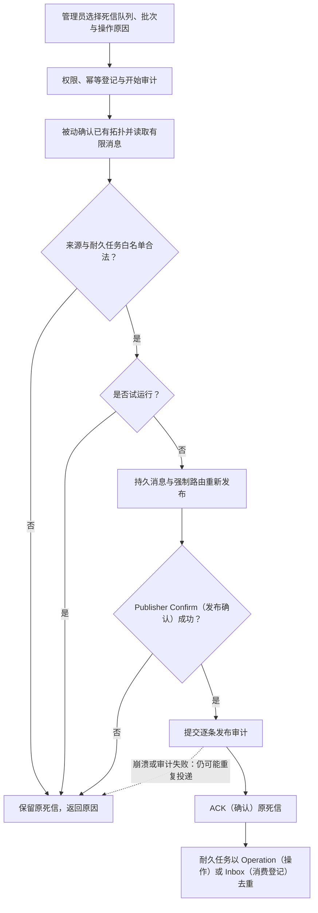

试运行不是冻结快照，实际重放的是那一刻可消费的批次，可能与预演不同。关闭通道会返还本批未确认消息。失败 Operation 的状态不会自动重置：先按任务管理流程审核并重试 Operation，再判断是否还需要重放消息；只做消息重放，Worker 可能因终态或有效租约而跳过。这个接口是 at-least-once（至少一次）运输，不是 exactly-once（严格一次）业务执行。

### 2026-10-06：发布确认到消费者认领之间的恢复

**implemented（已实现）**：恢复器检查仍待处理/待重试的操作，其最新 Dispatch 已发布超过默认 300 秒而未认领时，追加新代次并记录 `operation.redispatched`。只看最新代次，历史 published（已发布）行不反复触发；有活跃认领或最新代次仍等发布时不重投。初始代次后最多自动追加三代，仍无人认领则以 `operation_unclaimed` 失败，检查消费者后人工重试，避免无限复制消息。

重复消息由 Worker 的数据库 Claim（认领）和结果复用兜底，不保证 Broker“只投一次”。执行检查同时验证状态、Owner（持有者）、有效租约及 fencing token（栅栏令牌），过期但恢复器尚未运行时旧 Worker 也不能继续执行。真实 PostgreSQL 25 项定向测试含 8 Worker 竞争认领全部通过；最终 SQLite 157 项中 155 通过、2 项外部 Checkpoint 集成测试显式跳过。

**legacy-compatible（旧版兼容）**：只读 `audit_legacy_operations` 检出三条旧视频待处理投影，没有自动重放、删除或伪造完成。需先核对领域结果、原始文件和旧队列，再由业务入口恢复，不能把“清空任务中心”当成修复。

平台现在明确区分两种 Outbox（事务发件箱）：

- `OperationDispatchOutbox` 驱动 Resume、Career、Knowledge、Media、Community 等高成本命令；唯一约束为 `(operation, fencing_token)`，消息只包含 `operation_id`，queue/routing 由 allowlist handler registry（处理器白名单注册表）解析。
- `IntegrationOutbox` 发布已经发生的领域事实，保存 producer、aggregate、event type/version、严格 `EventEnvelopeV1`、payload hash、available time、attempt 和发布结果。递归敏感字段、深度、数组长度和总大小均受约束。

`OperationEvent` 是 append-only（只追加）耐久进度流，`(operation, sequence)` 唯一，状态变更与阶段事件同一事务提交；逐 Token 流只进入 Redis，Redis 丢失后从 PostgreSQL 快照与耐久事件恢复。`ConsumerInbox` 以 `(consumer_name, event_id)` 唯一，并具有 claim token、lease owner/expiry、fencing token 和 next attempt。数据库投影必须把“业务投影 + processed”放入同一事务；需要访问外部服务的消费者只创建 Operation + Dispatch，不在 Inbox handler 中直接产生不可恢复副作用。

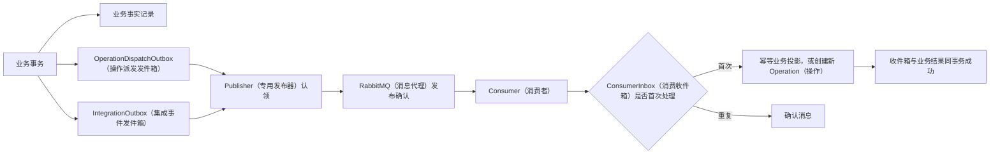

Publisher 多实例用 `select_for_update(skip_locked)` 认领；Mandatory Routing（强制路由）与 Publisher Confirm（发布确认）失败时保留数据库记录并按 `available_at` 指数退避。业务重试也由数据库的延迟 Dispatch 统一调度，不维护第二套 Rabbit TTL 重试时钟。Confirm 后、数据库标记前宕机允许重复发布，最终由 Operation claim/fence、Inbox 和领域唯一约束保证只产生一次业务结果。

## 8. RuntimePolicy 与限流准入

`RuntimePolicy` 让 queue、并发、超时、降级等策略可配置。不同任务成本差异大：Career 聚合是 DB 读，Resume render 占 CPU/外部工具，Agent/评估占模型预算，媒体占带宽/存储。统一每用户请求数限流不足。

准入已经以 Coordination Redis（协调 Redis）中的 Lua 原子脚本组合判断，避免先扣一个维度、再被第二维拒绝：

- user/IP/tenant/enterprise/deployment request rate；
- 同一用户、企业、任务类型、模型 Deployment、OCR、Embedding、Rerank、Render、Media 并发槽；
- queue depth/oldest age；
- Gateway budget；
- 系统 dependency readiness；
- Staff emergency flag；
- 幂等复用已有 Operation。

租约带 owner token，renew 与 release 都校验所有者；但最终正确性仍由 PostgreSQL fence 与唯一约束保证。用户/企业配额或槽不足返回 `429 capacity_limited`；Coordination、安全依赖或队列背压不可用返回 `503 dependency_unavailable`/`503 async_backpressure`，并带 `retry_after_ms`、correlation ID 和可复用 Operation ID。Coordination 故障时安全流程和高成本写 fail-closed（安全关闭），普通只读继续。

## 9. Community 与 Revision

2026-10-07 仅恢复原社区阅读风格，不回退内容事实源：`CommunityHub`仍读原生Feed及审批后的公开Revision（修订），保持原发布审核API和匿名规则。左侧栏目按内容类型筛选，右侧真实话题按返回的`topic_ids`筛选；当前页面只处理已加载列表。公开正文在阅读弹窗中以文本呈现，不注入HTML；匿名内容显示“匿名作者”。由于当前接口未提供访问/点赞统计，页面没有仿造旧Blog的热度数字，“推荐阅读”也不叫“热门排行”。历史Blog独立入口保留。合成UI检查不替代真实多用户权限、投稿审核/互动端到端测试。

Community 原生模型覆盖 Content、Revision、Comment、Reaction/Bookmark/Follow、Topic、Challenge、Reputation/Growth、Moderation/Appeal、Webhook 等。正文与 Revision 分离使审核、编辑历史和撤回可追踪。发布只指向已审核 revision。

内容状态机：

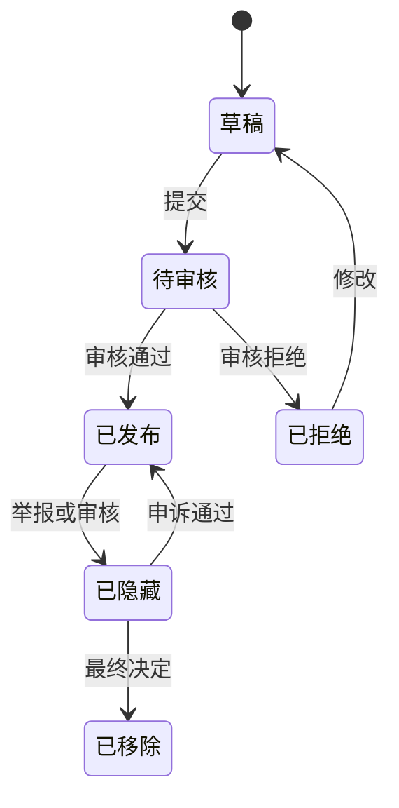

互动计数可用异步聚合/每日 metric，但 Reaction 唯一关系是事实源。不能只增减 count 而没有用户关系，否则重试和取消会漂移。Webhook 发送走 Outbox、签名、重试/DLQ。

旧 `interactions` 的 Like/Bookmark/Follow 与 Community 模型重叠，标为 `legacy-compatible`。收敛要先统计调用、双读对账、迁移关系、切写入、再删旧接口。

## 10. Blog

Blog 有 Category、Tag、Post、Comment、推荐/统计与 DailyPostStats。它适合平台文章，不承担用户社区全部审核语义。Post 的发布状态、作者、slug、时间、标签关系是权威；bookmark_count/统计是派生。

Blog 与 Community 的边界应按内容来源/治理决定，而不是都叫“文章”就合表：官方长文可在 Blog，用户原生内容在 Community。跨域展示用读模型或事件同步。

## 11. Chat

Chat 由 Conversation、Participant/ParticipantState、Message、MessageAttachment、Block/Report 与 ChatOutbox 组成。ParticipantState 保存每用户已读/隐藏/静音等状态，避免在 Conversation 上存一个全局 unread。

发送消息：

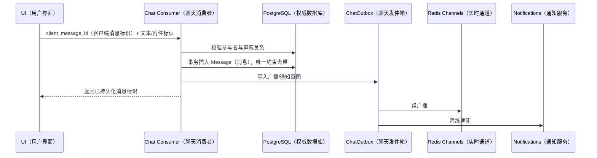

观察重点：先持久化再广播；attachment 必须扫描完成；block/report 在服务端检查；离线通知不依赖 WebSocket 在线。

面试时如何讲：说明 Redis channel 丢失后用户刷新仍从 PostgreSQL 补消息。

## 12. Notifications

Notification 保存用户、类型、标题/内容、data/link、read/created；NotificationOutbox 保存业务事件到通知投递的状态。用户偏好控制类别/渠道/免打扰。发布异步化，业务事务只写 outbox。

通知是 at-least-once，前端以 notification id 去重；未读计数来自数据库/缓存投影。链接必须是白名单内部 route，不能把外部不可信 URL直接渲染。删除源对象后通知仍可显示安全摘要，点击给出已失效。

## 13. PostgreSQL

PostgreSQL 16 是唯一关系运行库。连接 URL 经 `postgres_database_config()` 解析；可配置 conn max age、pool、server-side cursor。核心职责：

- 外键、唯一/check 条件约束；
- JSONB 版本内容/配置/trace；
- transaction/row lock；
- outbox/inbox；
- Staff 审计；
- Agent 业务执行。

Agent checkpoint、LiteLLM、Langfuse 等可有独立数据库/role，避免 schema/权限混用。生产 role 应分 owner/migrator/app/read-only/backup，app role 不应建库或读其他 DB。

索引以查询为证据：Career `(user,status,next_action)`、Outbox pending、Execution status/heartbeat、Knowledge revision/status、Ledger user/task/time。JSONB 大字段避免 SELECT *，列表用 projection。

## 14. Redis

开发与预发布 Compose 已将 Redis 拆为三个进程/故障域，而不是同一实例的 DB number：Cache 使用 `allkeys-lfu`，Coordination 与 Realtime 使用 `noeviction`。生产契约是三个托管故障域、`rediss://`、分域 ACL 服务账户和最小权限；本地单节点只能验证语义，不能作为生产 HA 证据。

唯一 Key Builder（键构造器）输出 `ifaceoff:<env>:<domain>:<tenant-or-global>:<resource>:v<schema>:<opaque-id>`。邮箱、IP、Token 等先 HMAC/hash；Coordination/Realtime Key 必须有 TTL；新 Key 写入与旧 Key 双读最多一个 24 小时 TTL 窗口。在线清理只能 namespace SCAN，禁止 `KEYS *`。

Key 例：

- `ifaceoff:prod:cache:tenant-42:career-dashboard:v2:<hash>`；
- `ifaceoff:prod:coord:global:admission:v1:<hmac>`；
- `ifaceoff:prod:realtime:tenant-42:operation-events:v1:<uuid>`。

验证码的值与 TTL 在一个 Lua/事务操作中写入，并带 resend generation；WebSocket Ticket 在一个 Lua 调用中完成 scope/resource 校验与原子消费，错误资源请求不会提前耗尽合法 Ticket。Single-flight leader lease 位于 Coordination，缓存结果位于 Cache；非 leader 只等待有限 deadline。Redis Stream 配置长度和 TTL，丢失后回到 PostgreSQL OperationEvent/Execution Snapshot。

## 15. RabbitMQ 与 Celery

稳定 Exchange（交换机）仍为 `ifaceoff.commands`、`ifaceoff.events`、`ifaceoff.dlx`；新队列统一使用 `ifaceoff.v2.*`，避免旧同名队列参数不兼容。Agent、Career、Documents、Resume Render、Media、Moderation、关键 Events 使用 Quorum Queue（仲裁队列），Notifications/Search 使用可重建的普通持久队列。关键队列配置 delivery limit、max length/bytes、`overflow=reject-publish` 与按域 DLQ（死信队列）。

Publisher/Recovery、Agent、Career、Document/OCR、Resume Render、Media/FFmpeg、Community Moderation、Events、Notification/Search 和单副本 Beat 分组部署；Document 不再与 Media 共用 Worker，Publisher 不再与 Notification 共用。全局 `prefetch=1`、late/manual ACK（延迟/手工确认）、worker-lost reject、soft/hard deadline 和子进程回收已配置。

本轮不再宣称存在 Rabbit TTL Retry Queue：业务错误由 PostgreSQL `OperationDispatchOutbox.available_at` 延迟重试，RabbitMQ 只负责运输、Worker 崩溃 redelivery（重新投递）和 delivery limit 后的 DLQ。管理端区分数据库 dead 记录与 Broker DLQ，耐久任务 Broker 试运行/重放已补入，范围与故障窗口见§7；旧任务自动重放及生产集群验收不在已通过范围。旧 406 队列采用新 vhost/版本队列蓝绿迁移，必须先被动盘点 ready/unacked/consumer/binding（待处理/未确认/消费者/绑定），再灰度、排空或受控搬运；禁止直接删除含消息的旧队列。详见 [[10-运行与故障手册]]。

## 16. Qdrant、Meilisearch、LiteLLM、Langfuse

Qdrant/Meili 是可重建索引，健康检查不仅 ping，还要 query/upsert 权限、collection/index schema 和 lag。LiteLLM 是 provider proxy，可有独立 PostgreSQL；业务 Gateway 仍保存租户策略和账本。避免业务层与 LiteLLM 两边都进行不透明重试。

Langfuse/ClickHouse 用于 LLM trace/指标。trace id 与业务 Run/Ledger 关联；脱敏后发送；观测失败不应阻断核心交易，但高风险评估若审计为强制可 fail-closed。保留期按隐私政策。

## 17. 对象存储、ClamAV、FFmpeg 与 Nginx

对象存储保存 Resume source/artifact、Knowledge source、Chat attachment、Interview media。bucket/prefix 按用途和敏感级别分；默认 private；下载短签；服务端加密/生命周期；数据库保存 key/hash，不保存公开 URL。

ClamAV 扫描是上传安全一环，不代替 parser sandbox。FFmpeg 处理不可信媒体要限制时长、分辨率、codec、CPU/内存和命令参数，禁止 shell 拼接。Nginx 限制 body、timeout、rate，正确代理 WebSocket/SSE（禁缓冲/适当 read timeout）。

## 18. 威胁模型

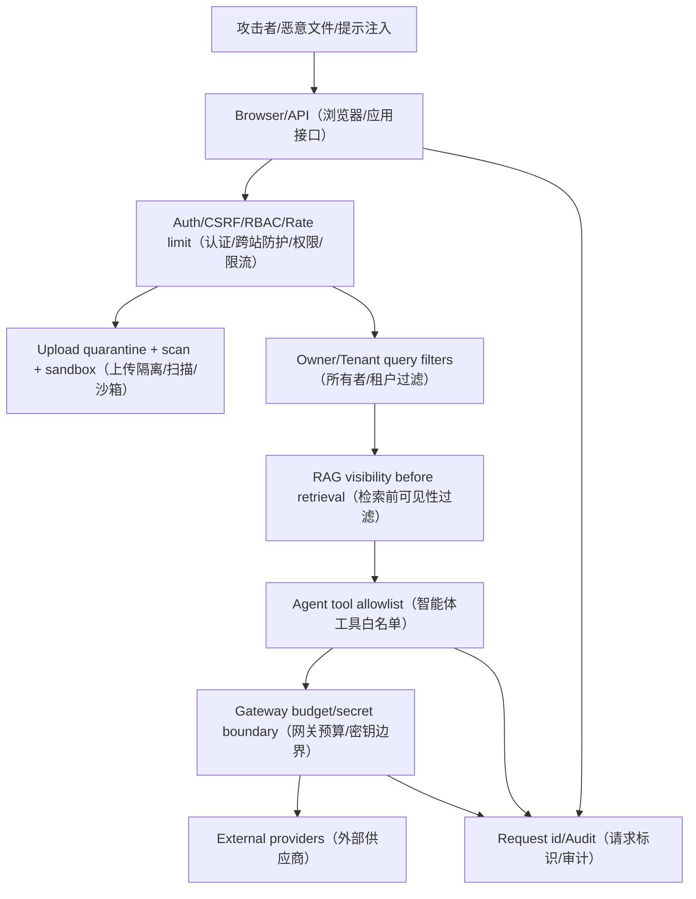

主要威胁：

- IDOR 读取其他用户 Resume/Session/Run；
- Staff 账号接管或权限扩大；
- OAuth state/redirect 攻击；
- 上传恶意文档、压缩炸弹、FFmpeg/解析器漏洞；
- RAG 跨租户和 prompt injection；
- 模型密钥泄漏和成本滥用；
- WebSocket/SSE 订阅未授权 run；
- Outbox payload/日志泄 PII；
- 公开分享 token 猜测和无限下载；
- Break Glass 无理由/无复核。

## 19. Secret 管理

Secret 通过部署环境/Secret manager 注入：Django SECRET_KEY、数据库、Staff MFA encryption、Provider key、OAuth secret、对象存储、Meili master、LiteLLM master/salt 等。`.env.example` 只放占位；文档和截图不含值。

轮换策略：

- 数据库/对象凭据支持双凭据窗口；
- ProviderCredential 新建切 deployment，再停旧；
- encryption key 轮换需 key version/重加密；
- Django SECRET_KEY 影响 session/token，需计划；
- 泄漏时撤销、审计、扫描 Git history、通知。

本地 fixture 密码和 TOTP 只从进程环境读取，命令输出只说明“来自环境”，不打印明文。

## 20. 隐私与保留

数据分类：公开职位/文章；账号资料；Career/Resume；回答/报告；媒体；Staff 审计；模型 trace。保留和删除不能一刀切：

- 用户删除：主对象、对象存储、索引、checkpoint、缓存、观测 trace；
- 合规审计：按合法期限保留最小元数据，正文脱敏；
- 分享访问：hash 化 IP/UA，短期保留；
- 媒体：默认短于文字报告；
- 备份：删除有延迟窗口，要在政策说明；
- 模型 Provider：配置不训练/保留策略。

## 21. 可观测性

事件与队列页新增 Broker 队列选择、读取 ready（待处理）深度、consumer（消费者）数、试运行和确认重放。ready 不含 unacked（正在处理且未确认）消息，完整积压仍结合 RabbitMQ Prometheus（监控系统）观察。逐条结果仅显示校验和、状态和保留原因；无正文权限。页面网络错误保留该次幂等键用于重试，不能把一次请求失败直接当作全部消息未投递。

2026-10-06 新增 `missing_domain_queues（缺失领域队列）` 和渲染、简历智能分析、媒体、文档、岗位分析独立运行能力。基础 Compose 配置定向 Worker 健康检查，避免其他进程应答导致假健康。单机合成证据不代替三节点仲裁、真实 Broker 指标告警和全链路验收。

实际启动后十个 Worker 对十二个主队列提供各一名消费者（辅助 Worker 消费三个可重建队列），缺失列表为空，单个 Beat（定时调度器）运行，HTTP readiness（就绪探针）返回 200，分领域能力为 true。监控交换机独立后不再出现 Worker 心跳落入业务队列的未知消息。运行中基础设施仍是历史单节点 RabbitMQ 3.13 与单 Redis，不把开发环境当成目标 4.3 集群或三个独立 Redis 故障域。

每个请求生成/透传 Request、Trace 与 Correlation ID，Operation、两类 Outbox、Celery task、Agent Execution/Run、Gateway Request/Attempt 和 Langfuse trace 通过关联 ID 串联。内部 `/internal/metrics` 不经公网 Nginx 暴露；指标不得以 user、tenant 或 Operation UUID 作为高基数 label，也不记录正文。

关键指标：

- HTTP rate/error/p95，按 route/status；
- DB pool/slow query/lock/dead tuple；
- Redis eviction/memory/stream lag；
- RabbitMQ ready/unacked/oldest/DLQ/consumer；
- Celery runtime/retry/failure/worker heartbeat；
- Agent execution state age/SSE replay/fallback；
- RAG index lag/empty context/cross-tenant rejects；
- Gateway budget/attempt/fallback/cost；
- upload scan/parse/transcode failures。

readiness 以 capability（能力）返回，不再把可选依赖压成一个布尔值：`ordinary_reads`、`security_flows`、`expensive_writes`、`async_acceptance`、`realtime` 可分别为 ready/degraded/blocked。探针覆盖 Cache SET/GET/DEL、Coordination Lua/TTL/write、Realtime XADD/XREAD/EXPIRE、Rabbit 拓扑等价性、关键 queue consumer、Publisher 与最老 Dispatch/Outbox；当前代码和 Compose 契约已具备，真实 Broker/Worker 指标采集与告警仍待 Docker/预发布环境验证。

## 22. 备份与恢复

PostgreSQL 做基备/WAL 或逻辑备份，必须演练到独立环境并执行模型级验证。对象存储启用版本/复制并对数据库 key 抽样。Qdrant/Meili 可从 PostgreSQL重建，但重建耗时纳入 RTO。Redis cache 不备份也能恢复；协调/实时需按业务容忍度决定持久化。

恢复顺序：数据库与 Secret → 对象存储 → Django read-only 验证 → Worker/Outbox → 索引重建 → 实时/外部 provider。不要先开 Worker 消费旧消息再验证 schema。

## 23. 测试策略

### 23.0a 管理端 Broker 重放验证（2026-10-07）

- 契约、平台和 Operation（权威操作）回归报告 `20261007T054417-553053Z/report.md`：99/99通过，其中新增死信模块16项。包括字段/队列边界、权限、幂等回放、输入冲突、审计、原始消息保密、确认→审计→原死信确认顺序，以及最终响应丢失/租约过期后禁止同键消费下一批。
- 真实专属 PostgreSQL/RabbitMQ 管理 API 报告 `operation-faults-20261007T054555Z.json`：5/5通过；之前054145报告也5/5通过。覆盖试运行/未知任务保留、Mandatory（强制路由）不可达、真实发布 NACK（拒绝）、逐条审计与幂等回放、只读角色拒绝。没有业务 Worker，不能替代原11项应用故障实验。
- 早期053641/053805/053915/054036失败报告保留：测试 Host（主机）白名单设置修正后，进一步定位 AMQP 被动交换机声明缺少必填 `type` 参数，修复并加强契约断言。Mock（模拟对象）通过未被当作真实组件通过。
- 管理端 TypeScript/生产构建、Django 检查与无新迁移通过；浏览器真实页面使用合成 API 响应走通队列选择、原因填写、试运行与确认结果，只算界面交互检查。未完成真实 Cookie/CSRF/浏览器/Broker 一体闭环、4.3多节点故障与生产部署审计验收。详细截图登记见§13附录。

### 23.0 固定到达率、事务吞吐与真实命令故障（2026-10-07）

#### 创建链优化与真实DLQ（死信队列）协议补测

最终完整入口报告`operation-faults-20261007T052251Z.json`：8项应用命令故障与3项Broker（消息代理）DLQ协议共11/11通过，不再只拼接不同运行的结果；仍为单节点合成实验，管理端能力未验收。HTTP复测`authenticated-http-20261007T052020Z.json`：两条读取各800/800，模板/列表p95=106.929/71.466ms，40/40创建及主库核验成功、p95=312.110ms，短窗口53.548 TPS。简历32项与平台/Operation（异步操作）83项回归通过（两组有交集，不能相加成唯一测试数），脚本/文档28项通过。

合成创建剖析新增5次外层事务回滚，核对主库简历数量不增加；不输出SQL正文/参数，不计回滚样本TPS。发现重复策略读取、空内容校验和新建关联回查；在保留事务/行锁的前提下实现创建作用域去重与响应关系缓存，SQL27→22、SELECT15→10。真实HTTP首轮40/40持久化验证成功，p95=411.083ms，原同档基线544.543ms；单轮改进不等于稳定门禁。

`--broker-dlq`只创建专属RabbitMQ，Quorum（仲裁队列）投递上限2，实测3次拒绝重投后进入DLQ。读取`x-death`（死信来源头）核验原队列和`delivery_limit`（投递耗尽原因），dry-run（只读预演）重新入队不删除原死信；把目标队列填至真实Publisher Confirm NACK（发布拒绝），重发失败后不ACK（消费确认）原死信；腾出目标容量，重发确认成功后才ACK原死信，最终目标收到相同合成ID、DLQ为0。Quorum长度限制为近似边界，实验等待实际NACK，不假设刚好1条就拒绝；队列可见计数按异步收敛等待。

051921报告3/3通过，051620/051833早期失败保留。这是当时的 Broker 协议层实验，不是管理端功能证据。后续新增管理接口、权限/幂等/审计和页面，分别使用 `--groups broker_admin` 与 `--broker-admin-real` 验证；页面合成响应交互检查仍不等同于真实登录、Broker 与浏览器全链验收。真实组件早期错误报告保留，不能抹去失败轮次或用 Mock（模拟对象）通过掩盖真实协议调用差异。

#### 后续诊断：先校验施压工具，再讨论后端瓶颈

最终10秒/路由池化复测 `authenticated-http-20261007T050637Z.json`：两条读取分别800/800，成功约79.926/79.904 QPS（路由顺序测，不相加成整体160 QPS），p95=247.073/107.347ms，均满足普通接口500ms目标；调度p95≈0.56ms、零丢弃。40次创建均数据库核验，38.059短窗口TPS，p95=598.445ms，`ordinary_api_p95_met=false`（普通接口延迟目标未达）。仍需优化写入链与验证持续写入压力；已完成的80次/秒只针对两个读取端点、16用户、单进程本地环境，不代表500在线、全模块或生产容量。当前8000服务与默认连接池设置未被修改。

早期认证请求每次调用 `urllib.request.build_opener()`，默认 HTTPS（加密传输）处理器会初始化系统证书上下文，即使URL是HTTP（普通传输）。本机20次构造微实验平均29.853ms；共享验证上下文后0.329ms。工具现按线程复用客户端，仍禁用代理和跳转，证书校验没有关闭；调度及线程等待改用高精度计时，避免Windows粗粒度时钟给出虚假0ms。`authenticated-http-20261007T045818Z.json` 在修复前64槽施压仍出现调度p95=2.397/4.178秒，不能把其吞吐当服务端极限。

专属ASGI（异步服务接口）进程只绑定临时回环端口，**复用开发数据库与缓存**，账号和写入均为合成数据；不重启用户8000服务，不是完整资源隔离。对照只切换子进程 `POSTGRES_POOL_ENABLED`（数据库连接池开关），进程池上限沿用已有10连接配置。无池列表p95=783.887ms（050211报告）与208.749ms（050439复测）波动明显；池化两轮为84.580/59.976ms（050229/050339报告）。多项环境因素仍在变化，不把全部差异归因于连接池或ASGI服务器，也不据此迁移框架。050211/050229早期启动测试在Windows清理日志时失败，数据报告保留但不是完整入口通过；已修复专属进程树停止，并通过050339/050439复测。

050339池化场景：两条读取各400/400、零背压和错误，成功吞吐约79.846/79.758 QPS，模板/列表p95=213.142/59.976ms；40/40写入主库核验成功、39.293短窗口TPS、p95=568.908ms，**写入延迟目标未达**。调度p95约0.56–0.59ms，线程等待p95约0.15–0.42ms，施压端已经跟上；小于等于约1秒的写入窗口仍不是持续吞吐验收。新增 `performance_checks`（性能门禁）单独表示普通接口p95≤500ms及计划负载完成，功能通过不等于性能通过。

`operation-faults-20261007T050020Z.json` 8/8通过，新增真实 Publisher（投递器）在Broker确认返回后直接退出，Outbox（命令表）仍为publishing（投递中）。暂停本次专属消费者，确认Broker中1条消息，推进投递锁过期后重新发布，确认2条消息，再启动Worker（执行器）；两条均消费完成，业务尝试仍1次、产物与成功事件各1。投递锁的5分钟等待被人为推进，报告7.855秒仅是**加速时钟后的恢复执行耗时**，不是线上真实恢复SLA（服务目标）。其余租约崩溃仍实际等待15秒。没有删除旧消息或修改生产投递代码来制造通过。

加强消费回执后的复测 `operation-faults-20261007T045214Z.json` 为7/7通过：Broker（消息代理）恢复13.586秒；结果前/产物落库后崩溃恢复21.236/21.288秒，旧栅栏拒绝且尝试数2；成功提交但 ACK（消费确认）前崩溃恢复3.281秒，重投任务完成回执已出现、尝试数仍1、产物和成功事件各1。终态重投无需重新 claim（取得执行权），因此该场景 `old_fence_rejected=null` 表示不适用，不能伪称执行了 fence（栅栏）拒绝测试。取消到数据库终态15.581ms，取消场景没有产物；3次业务重试耗尽8.865秒。整体 `partial` 指覆盖范围有限，而非这7项失败。临时 Worker（执行器）和拥有标签的隔离容器完成后已清理，开发服务没有被停止。

80次/秒阶梯探测（`authenticated-http-20261007T045144Z.json`，16账号/16客户端槽）未完整达到计划负载：模板400次计划只发送200次，简历列表发送201/400，客户端丢弃200/199；已发送全部200且无429/5xx/超时，成功吞吐38.791/38.434 QPS，p95=411.162/356.876ms。写入计划40次仅发送24次，24次主库核验均成功，丢弃16次，短窗口30.928 TPS、p95=344.016ms；不足一秒的写入窗口不能作为持续吞吐结论。必须同时看“已发送成功率”和“计划负载完成率”（50%/50.25%/60%），不能将100%已发送成功率包装成80 QPS通过。当前单机开发环境与同机故障实验、客户端槽上限共同影响结果，尚未定位服务端饱和原因，不能直接归因 Django 或推导改用 FastAPI 即可解决。

运行证据 `operation-faults-20261007T044944Z.json`：7个场景通过。Broker（消息代理）恢复13.408秒；两种非终态 Worker（任务进程）崩溃恢复21.419/21.355秒（含15秒真实租约等待），成功后未确认消费场景3.189秒；结果均唯一。取消到数据库终态33.5毫秒不等于外部计算已停止；3次业务重试耗尽8.670秒。早期实验失败文件仍保留。后续实验增加 Celery `task_postrun`（消费任务结束信号）的本地回执核验，只有重投任务真正结束才算消费完成，终态重投不把未执行的栅栏校验标为通过。

`--http-arrival-rate` 按计划时刻发请求，不等待上一请求完成；并发槽满时记录 `client_backpressure_drops`（客户端背压丢弃），禁止用无界排队掩盖施压不足。请求 QPS、成功 QPS 与数据库核验 TPS 分列。`--http-writes` 最多40次简历创建；同轮读取先执行，避免新增数据改变读取样例。20次/秒基线240/240正确，写入约19.16 TPS、p95=117.360ms，客户端丢弃/429/5xx/超时均0；这是成功低负载基线，不是极限值。

`--operation-faults` 使用拥有专用标签的临时 PostgreSQL、RabbitMQ、媒体目录和 Celery Worker（任务执行进程），复用 `publish_operation_dispatch_outbox`、`execute_operation` 与 `resume.export` JSON 处理器。通过进程直接退出注入“结果前”“Artifact（产物）落库后”“Operation（操作）成功提交但 ACK（消费确认）前”的崩溃，实际等待15秒租约过期，验证恢复、旧 fence（栅栏）拒绝和结果唯一性。取消和业务重试耗尽另测。Publisher（投递器）由实验显式运行，投递退避仅在停机恢复场景加速；不证明 Beat（定时调度）高可用、外部进程取消、多节点仲裁或全部领域恢复。具体通过情况以报告逐项结果为准，不用脚本存在代替运行证据。

认证测量新增 `--authenticated-http`（合成账号接口负载），参数 `--http-users` 为 1..16、`--http-concurrency` 为 1..64、`--http-duration` 为每路由 1..120 秒。每个 Worker（请求线程）固定使用一个新建合成身份，采用本地 HTTP（网络接口）与真实运行数据库。JWT（短期身份令牌）有效期五分钟，仅写入自动清理的临时文件；认证请求禁用代理与重定向，不打印请求头。2xx 还必须通过业务响应校验才能计为成功吞吐；返回 200 但内容/用户归属错配时计失败。四用户基线与八用户测量均保留，不能与匿名 CSRF（防跨站请求）配额混为一谈。

2026-10-07 八用户测量：模板 101.023 成功 QPS（每秒正确响应）、p95 104.842ms、p99 183.488ms；个人简历列表 76.783 成功 QPS、p95 141.884ms、p99 201.028ms，共 894 请求，429/5xx/超时/内容错误均为零。单机开发服务、两个小数据只读路由、五秒闭环实验，不代表最大容量、生产 TPS（事务率）、企业维度限流或 500 在线用户目标。

显式真实渲染组 `render_matrix`（模板矩阵）以本地 RenderCV（排版器）运行 24 个模板/语言/纸张组合，测量独立进程排版耗时和正文文本层。2026-10-07 完成六模板的单页/双页实例，均保留末尾条目；没有三页、像素黄金图、字体嵌入与边界溢出证据，不能把这 24 个组合称为全部渲染门禁通过。

2026-10-07 HTTP（网络接口）脚本支持重复 `--url`，统一入口透传重复 `--http-url`。路由独立报告总 QPS（请求率）、成功 QPS、成功比例、429/5xx/传输错误比例。仅 2xx 算成功；有 429 时报告 `partial`（部分验证），`throttle_correctness` 为 `pending-verification`（待验证）。路由按顺序测量，共用本机 IP；受保护路由的匿名 401 保留为失败，不能充当成功吞吐。

本轮 CSRF（跨站请求防护）引导接口：1305 请求/10.022 秒，总 130.219 QPS、成功 7.883 QPS，79 个 200、1226 个 429，总响应 p95 88.824ms。模板目录未认证返回 401，组合 HTTP 测试因此失败。隔离 PostgreSQL（数据库）65 项通过；Redis（缓存）停机恢复写能力约 18.685 秒，RabbitMQ（消息代理）持久消息重启恢复约 18.002 秒，包含容器停止/启动时间。协议测试通过不表示应用补偿或集群高可用已通过。

浏览器 `--repeat` 独立创建合成账号，输出 `output/playwright/browser-evaluation-summary.json`，仅通过样本进入分位数，失败仍保留并使整体失败。正常导出已经过 Publisher（投递进程）、RabbitMQ 与 Render Worker（排版执行进程），下载正文/校验和及成功 Operation（异步操作）均复核；崩溃、取消、重试耗尽与 DLQ（死信队列）需另做故障注入。

### 不需要模型和检索的统一评估入口

真实模式：`--real-infra` 创建有唯一前缀与所有权标签的三个 Docker（容器运行环境）实例，端口只发布到本机回环地址。PostgreSQL（权威关系数据库）通过临时测试数据库运行原状态机测试，包含八线程竞争领取，网络保护仅允许指定数据库端口；Redis 与 RabbitMQ 测试仅停止/启动本轮专属容器，绝不操作应用实例。清理前检查容器所有权标签，仅移除本轮资源。Redis 停机后的连接拒绝、无持久化缓存丢失与恢复写能力、owner（持有者）释放与租约过期分别验证；RabbitMQ 采用发布确认与持久消息，检查未 ACK（消费确认）断连重投递以及重启后消息保留。协议消费者断连不是 Celery 进程崩溃；单节点 RabbitMQ 3.13 结果不是 4.3 多节点高可用验收。

`--browser` 使用 Playwright CLI（浏览器自动化命令入口）、本地 Chrome 与合成音视频设备。预置独立合成账号、简历和问题，不走 AI 出题；用真实 UI 登录/刷新/修改/录制/上传，并从 PostgreSQL 核对草稿与视频 Operation（异步操作）/文件/会话绑定。没有回答时报告生成不在验收范围，不允许称其已通过。刷新失败后重新登录只用于继续独立录像测试，失败仍保留。测试凭据只出现在本地短期文件，完成后删除；CLI 回显不写入报告。合成业务数据保留以便日志定位。完整报告仍不能证明所有功能或生产服务目标。

`scripts/run_deterministic_evaluation.py` 是离线测试协调器，不新增业务 Operation（异步操作）、线上 API 或第二套评估数据库模型。每轮子进程采用 Django test settings（测试设置），新建临时 SQLite 与媒体目录，回归完成后销毁；`socket.connect/connect_ex` 拦截禁止网络访问，意外调用模型、RAG、Redis 或 Broker（消息代理）应失败而不是消耗真实服务。失败日志只使用合成测试数据，不录入真实凭据或简历。

入口包含 Operation（异步操作）状态机、Redis 契约、Worker 隔离、简历、视频命令、接口采样和 `platform` 确定性业务组。`platform` 运行账号与 Cookie 会话、Mock GitHub OAuth 契约、Career 归属、Community 匿名与 PII、Chat 幂等、Staff RBAC/审计，以及简历版本、导入、导出与分享测试；它不触发模型/RAG 执行。SQLite 跳过的数据库并发用例计为 `skipped`（跳过），不得计为通过。真实浏览器 `--browser-platform` 单独验证新标签会话恢复及 Studio 自动保存。

评估环境的 default（缓存）、coordination（协调）、realtime（实时）三个缓存别名均使用独立进程内缓存，并在应用导入前绑定，防止模块级缓存引用仍连接开发 Redis。队列背压契约用例同时隔离 Redis 构造函数与令牌消费：它们验证数据库中某一队列积压不会阻塞其他队列，不假装验证真实 Lua（原子脚本）。接口耗时采样在每次请求前重置自己的本地缓存以避免限流样本互相影响，因此明确不衡量限流或真实缓存性能。

接口采样验证真实 View（接口视图）和数据库业务结果，覆盖创建简历的内容/设计快照、六套模板返回以及跨用户 Operation 404（不存在）隔离。每项报告样本数、p50/p95/p99（延迟分位数）及最大值；简历创建额外记录顺序提交的本地请求速率和已成功数据库写 TPS（每秒事务数）。可选 `scripts/http_qps_evaluation.py` 或入口 `--http-benchmark` 对本机 CSRF（跨站请求防伪）引导 GET 做并发 HTTP 请求，记录总请求、200 与 429、QPS 和延迟；它不执行业务写，故 `business_tps=null`。该闭环样本不代表固定到达率、生产数据库容量或 500 在线用户，`slo_passed=null` 也表示没有验证生产服务目标。测试用例总耗时单独使用 `test_duration_ms`，禁止拿它当接口 p95。

可选 `--media` 使用本机 FFmpeg/FFprobe（媒体生成与探测工具）制作两个合成片段、合并转码为 MP4 并检查时长和音视频轨道，记录文件大小、转码时间及处理比。它是二进制真实执行，不是浏览器上传/Operation/Worker 全链路；缺少工具为 `pending-verification`（待验证），不伪装通过。完整报告总状态始终至多 `partial`，断言/启动/超时失败则 `failed`；限定回归通过时退出 0，失败退出非零。AI、RAG、真实语音和生产 SLO（服务目标）明确不在覆盖范围。

测试金字塔：

- 单元：hash、状态、contract、切块、RRF、budget；
- Model/DB：约束、事务、并发、migration；
- API：auth/owner/RBAC/CSRF/idempotency/error；
- Task：真实 broker/worker 与重复投递；
- Integration：PostgreSQL、Redis、Qdrant、Meili、Object/ClamAV；
- E2E：Candidate/Staff 页面与 API 数据；
- Security：IDOR、上传、OAuth、WebSocket/SSE、prompt injection；
- Reliability：kill worker、broker down、Redis eviction、index drift；
- Capacity：k6 请求/队列/Agent 并发。

当前本地证据为：Django 全量发现 304 项，其中 302 项通过、2 项外部 PostgreSQL Checkpoint 测试因未启用集成环境而显式跳过；`manage.py check`、`makemigrations --check --dry-run`、Candidate/Admin 两个生产构建与聚焦并发/状态机/Redis/模型网关测试通过，四组 Compose config 沿用基线验证。Docker daemon 不可用，因此真实 Rabbit/Redis/Celery 容器、三节点 Quorum 故障、外部 Checkpoint、500 用户负载与灾备演练均为 pending-verification，不能用静态 Compose 或页面 heading 代替。

## 24. 部署与回滚

部署顺序：

1. 备份/检查 migration；
2. 部署向后兼容 schema；
3. 运行 migration；
4. 部署 Django；
5. 验证 read/write/readiness；
6. 部署 Workers/Beat 并检查队列拓扑；
7. 部署 Candidate/Staff/Nginx；
8. 运行 smoke/E2E；
9. 逐步开 Feature Flag。

回滚代码前确认新写数据是否旧代码可读；破坏性 schema 分 expand-migrate-contract 三阶段。队列、Prompt、索引和 Gateway policy 也需要版本回滚，不只回滚容器镜像。

## 25. 当前生产差距

- 单机/本地 Compose 不是多 AZ；
- 三 Redis 进程和 ACL/TLS 契约已落代码，但托管多故障域、容量告警与故障切换尚未验收；
- `ifaceoff.v2.*` 拓扑已落代码，旧队列 passive inventory、受控 shovel 与三节点故障演练待预发布验证；
- Broker DLQ 监控和受控 replay 尚未完成，数据库 dead record 不能冒充 Broker DLQ；
- 外部 PostgreSQL Checkpoint 与真实 Worker 本轮未完整跑通；
- Beat 仍要求单副本，没有独立 leader lease；
- 没有当前完整容量基线；
- 备份/恢复与灾备演练证据不足；
- Secret manager、外部 trace 脱敏、隐私删除全链仍需生产验收；
- Community/Chat 审核与滥用防护需要规模验证。

这些应作为 Roadmap，而不是用 `production_readiness=90%` 之类无证据数字掩盖。

## 26. 30 秒口述卡

“平台层把候选人身份和独立 Staff/MFA/RBAC 分开，用 Idempotency、AsyncOperation、Outbox/Inbox 和数据库约束保证可重试；RabbitMQ/Celery 承担异步，Redis 按缓存/协调/实时拆故障域，PostgreSQL 保存权威状态，索引和对象都是投影。上传经隔离扫描，模型密钥走 Gateway，所有 Staff/Agent/模型调用用 request/run/ledger id 串审计。”

## 27. 2 分钟口述卡

从 Candidate 与 Staff 双身份讲安全；用 Outbox/Inbox 讲至少一次；讲 Redis 三域和 RabbitMQ 队列迁移；讲 Community/Chat/Notification 的持久化后广播；讲 Secret、上传、审计、备份和部署。最后列出当前从零迁移成功与 Worker/页面真实缺口。

## 28. 连续追问

**Outbox 会不会无限增长？**<br>
按状态/时间分区或归档，publisher 索引 pending，成功事件设保留期；审计需要的摘要另存。清理前确认消费者和重放策略。

**Redis 全挂怎么办？**<br>
缓存回源；协调/实时进入 degraded/readiness failure，停止新 Agent/高风险任务；业务状态仍在 PostgreSQL；连接恢复后按 Execution/Message/Event 快照重建。

**RabbitMQ 队列参数为何不能直接改？**<br>
durable queue 的 DLX 等声明参数是协议身份的一部分，同名不等价会 406，防止客户端误接错误语义；必须迁移队列/vhost。

**审计哈希链是否绝对防篡改？**<br>
不是。它能发现局部修改；管理员可重算。要外部只追加锚定、权限隔离和备份。

**如何删除用户 RAG 数据？**<br>
事务标记/删除主库 revision，Outbox 触发 Qdrant/Meili/object/checkpoint/trace 清理，记录 tombstone 和重试，查询先按主库/tenant过滤防删除窗口泄漏。

## 29. 身份链路：Candidate 与 Staff 为什么不能共用一个“is_admin”

候选人注册、登录、GitHub OAuth、隐私请求和通知偏好服务于个人求职闭环；Staff 管理 Agent 配置、
知识发布、模型凭据、审计和运维，风险等级完全不同。把两者放进同一登录页面、同一 token audience
或一个 `is_staff` 布尔值，会让前端误路由、Cookie 作用域、会话撤销和审计主体都变得含糊。

Candidate 请求仍需 owner permission：已登录并不等于可读任意 Resume/Interview。Staff 也不是天然
可见所有候选人正文；RBAC 应按 resource/action/tenant 决定，敏感操作要求 MFA freshness，
Break Glass 是有时间、理由、范围和复核的例外，而不是超级管理员后门。页面隐藏按钮只是体验，
服务端 View/permission 与对象过滤才是边界。

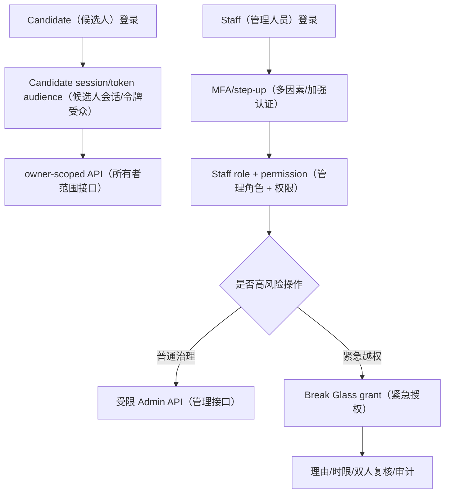

观察重点：身份、角色、对象权限和临时高权限是四层，不由一个字段替代。

面试时如何讲：选“查看 Agent Trace”和“轮换 ProviderCredential”两个操作，说明为什么后者需要
更强的 MFA、审计和最小权限；再讲候选人删除请求为什么不能被普通运营随意读取。

密码与 TOTP seed 不能进入文档或 seed 默认值。本次 `seed_documentation_demo` 只在 DEBUG 且
`ALLOW_DOCS_DEMO_DATA=1` 时运行，临时密码/TOTP 由进程环境传入；namespace 让重复执行复用数据并
可定向清理。这个命令是本地维护接口，不是生产 bootstrap。

## 30. Outbox/Inbox 的数据库视角

高成本命令的业务输入快照、Operation 和 `OperationDispatchOutbox` 同事务创建；已经发生的领域事实
则由 `IntegrationOutbox` 发布。publisher 以 `select_for_update(skip_locked)` 批量认领到期记录，
通过 handler allowlist 确定固定队列，使用持久消息、Mandatory Routing 与 Publisher Confirm。
若 Confirm 后进程崩溃，记录仍可重发，因此 Operation claim/fence、Inbox 和领域唯一约束共同处理重复。

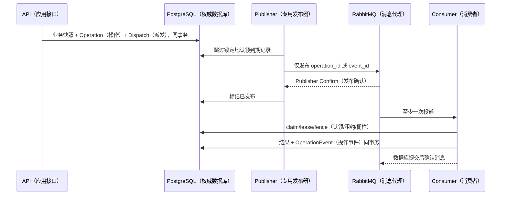

观察重点：Outbox 解决“数据库提交与消息发送”之间的丢失窗口，不消除重复；Inbox/业务唯一约束
解决重复消费。

面试时如何讲：主动讲 publisher 在 confirm 后宕机的窗口，说明为什么系统选择至少一次，再给出
consumer 的唯一键和事务顺序。不要说“RabbitMQ 保证恰好一次”。

两类 Outbox 均有 pending/available/attempt 索引；Operation Dispatch 的消息不携带正文，Integration
Event 只传必要 ID、状态和有限摘要。Operations 页面已展示数据库 dead/retry/stale lease，但 RabbitMQ
Broker DLQ 的读取与受控 replay 仍为部分完成，必须等原 exchange/routing/header 校验、Confirm、失败不
ACK 原死信、权限/幂等/原因和审计全部接通后才能称为已实现。

## 31. Community、Blog、Chat 与 Notification 的连续链路

用户发布 Community 内容时，当前 revision 与历史 revision 分开能支持编辑审核和申诉。互动关系、
声誉与挑战属于社区域；旧 `interactions` 点赞/收藏/关注和 `questions` 题库是兼容层，应通过适配
或迁移逐步收敛，不能让两个计数源永久双写。Blog 更偏公开内容、分类标签、评论和统计；与 Community
共用展示组件不意味着数据生命周期相同。

Chat 的权威顺序在数据库消息，不在 WebSocket。发送请求先校验会话成员、屏蔽/举报和附件状态，
写 Message 与 Chat Outbox，再广播。接收方离线时消息仍存在；重连按 last message id 拉取缺口。
附件必须先隔离扫描，不能因它来自登录用户就直接公开对象 URL。删除/撤回也要保留最小审计和对
参与者一致的 tombstone 语义。

Notification 是下游投影：社区回复、面试完成或任务失败产生领域事件，通知消费者依据
NotificationPreference 建站内通知/邮件等投递。偏好是在投递时读取还是在事件时 snapshot，需要
明确产品语义；安全告警不能被普通营销偏好关闭。投递 Outbox 的重复执行以 notification/event/
channel 唯一，邮件 Provider 失败与站内通知失败分开记录。

| 链路 | 权威状态 | 实时/异步层 | 典型一致性规则 |
|---|---|---|---|
| Community edit | Content + Revision | 审核/搜索投影 | 当前 revision 指针 |
| Chat send | Message | WebSocket broadcast | client id/sequence 去重 |
| Notification | Notification | delivery outbox | event+recipient+channel 唯一 |
| Legacy interaction | 收敛目标模型 | 兼容 adapter | 禁止永久双写无对账 |

## 32. Redis 三故障域的运行含义

开发/预发布 Compose 现在使用三个 Redis 进程，Cache、Coordination、Realtime 不再只是 DB number。
这验证了不同 TTL、eviction、ACL 与降级语义，但单主机仍不是高可用。生产目标是三个托管故障域；
任何“HA 已验证”声明都必须来自多节点故障与恢复证据，而不是本地 Compose。

Cache 可以丢，恢复时回源 PostgreSQL；key 必须包含 schema/tenant/version，避免旧结构污染。协调
键承载限流、semaphore（信号量）、single-flight lease（单飞租约）时，丢失可能导致并发执行，业务仍需数据库 fence/唯一约束；Redis 锁不是
最终正确性。Realtime pub/sub 只做低延迟通知，断线缺口从 Chat Message/Agent Event 的 durable
store 补。把 SSE 权威序号只放 Redis 会在重启后无法恢复。

内存满时不同域的正确动作不同：Cache 可以 eviction；coordination 不应随机淘汰关键 lease；
realtime 可以丢瞬时广播但要告警。Readiness 也应按能力表达：缓存不可用可保持 ready/degraded，
幂等协调或 Agent event 依赖不可用可能拒绝高风险新任务。

## 33. RabbitMQ 406 的现场含义和安全处理

本次文档环境的 Worker 连接默认 vhost 时，Broker 对 `celery`/`notifications` 队列返回
`PRECONDITION_FAILED (406)`：已有 durable queue 的声明参数与当前代码期望的 DLX 参数不一致。
RabbitMQ 把 durable queue 的这些参数视作身份，拒绝客户端用同名队列偷偷改变语义。这不是网络
不通，也不是重启 Worker 能解决。

代码侧已通过 `ifaceoff.v2.*` 新队列名避免对旧同名队列做参数覆盖；但真实环境仍必须执行以下安全迁移：

1. passive 查询 queue arguments、message count、unacked、consumer 与 bindings。
2. 确认 vhost/queue 的所有者和数据是否可丢，生产必须有变更窗口与回滚。
3. 在隔离 vhost 声明稳定 exchange、`ifaceoff.v2.*` queue、按域 DLQ，再启动 canary consumer（小流量消费者）。
4. 停止旧生产者，排空/受控 shovel 旧消息，验证业务幂等。
5. 观察新队列后才删除旧队列；删除动作另行授权并审计。

本轮没有删除默认 vhost 的任何现有队列。四组 Compose config 已通过，但 Docker daemon 不可用，
所以 passive inventory、隔离 vhost、canary、排空/shovel、每队列消费者 readiness 与 Broker DLQ
仍标记 pending-verification。静态配置通过不能替代真实 Broker 验收。

## 34. PostgreSQL 备份恢复不是“有一个 dump”

备份策略要先定义 RPO/RTO、数据域与加密。业务库、Agent checkpoint 库、对象存储和搜索/向量索引
的恢复优先级不同：PostgreSQL 是权威源，Qdrant/Meili 可从 revision 重建；对象文件若不可再生则
必须纳入独立版本/复制；checkpoint 可丢的范围由正在执行任务的恢复承诺决定。

一次合格演练包括：在隔离环境验证备份 hash/解密；恢复数据库；运行 migrations/check；
核对行数与关键约束；重建索引到新 physical collection/index；验证对象引用；启动只读冒烟；
再验证写入和 Outbox backlog。恢复脚本成功退出不等于业务恢复，必须用候选人/Staff关键流程验收。

PITR 场景要处理“数据库回到 T0，但对象/消息已经到 T1”的时间错位。稳定对象 key 和可重放事件能
帮助 reconciliation；恢复后先冻结外部副作用，确认 Outbox/Inbox/Artifact/Ledger，再逐步开放。
任何生产恢复都记录操作人、时间、备份 id 和验证结果。

## 35. 威胁模型按数据流展开

公开入口面对凭据填充、OAuth state 劫持、注册滥用和 CSRF；Candidate API 面对 IDOR、批量枚举和
公开 ShareLink 泄漏；上传面对恶意文件、压缩炸弹和解析器漏洞；Chat/Community 面对 XSS、垃圾内容
和骚扰；Agent/RAG 面对 Prompt Injection、跨租户检索和工具滥用；Staff/Gateway 面对 MFA 绕过、
Secret 泄漏与高权限误操作。

防护必须落在对应边界：

- 浏览器：Secure/HttpOnly/SameSite Cookie、CSRF、CSP、输出编码和受控 CORS。
- API：认证、对象权限、限流、字段白名单、幂等和一致错误语义。
- 数据：tenant/owner filter、加密、保留期、备份权限和审计。
- 上传：隔离区、大小/类型/解压限制、ClamAV、解析 sandbox、短期签名对象。
- AI：system/untrusted context 分层、结构化输出、tool registry 权限、RAG filter、Gateway Secret。
- Staff：独立 audience、MFA freshness、RBAC、Break Glass、双人复核和不可忽略告警。

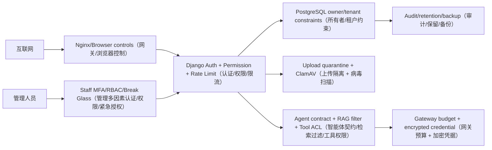

观察重点：没有一个“安全中间件”能覆盖所有数据流；每层阻止不同攻击并留下不同证据。

面试时如何讲：选择一个恶意简历文件和一个 RAG prompt injection，分别走完上传与 AI 链，证明
你能把安全要求翻译成模型字段、任务状态和权限代码，而不是只说 HTTPS/JWT。

## 36. 可观测性：一条业务链应该怎样被找到

Nginx/Django 生成或透传 request id；异步创建 operation/outbox/dispatch id；Agent 有 execution/
run/node/event；RAG 有 revision/retrieval trace；Gateway 有 ledger/attempt。日志以这些 id 关联，
指标按 endpoint/task/model/status 聚合，但不要把邮箱、简历全文、Prompt Secret 当 label 或默认
日志字段。

核心 SLI 可按产品承诺定义：

| 能力 | SLI | 告警线索 |
|---|---|---|
| Candidate API | 成功率、P95、5xx | endpoint/request id |
| Resume render | 接受到 ready 的耗时、失败率 | queue/artifact/renderer |
| Interview Agent | queue wait、execution age、event gap | execution/run |
| RAG | ready latency、zero-result、degraded rate | revision/profile |
| Gateway | success、fallback、unknown usage、cost | alias/deployment/ledger |
| Notification | event 到站内/外部投递延迟 | event/channel |

Liveness 只说明进程能运行；readiness 应验证此实例是否可接流量；dependency health 独立暴露
PostgreSQL、Redis、Broker、对象/索引/模型状态。不要因可选 Langfuse 挂掉让整个 Candidate API
退出，也不要在 checkpoint 必需时仍返回绿色总健康。

## 37. 发布、回滚与 Schema 兼容

数据库迁移遵循 expand/migrate/contract：先加可空字段/新表并让旧代码仍工作，再回填并切读写，
最后在确认没有旧实例后收紧约束/删除旧字段。`resumes.0008` 的修复说明 migration operation 顺序
也属于运行代码：RunPython 使用历史模型时，所需字段必须先由 AddField 建立。MigrationExecutor
从 0007 带历史数据迁移，才能覆盖这个真实窗口。

前端和后端发布不原子，所以 v1/v2 contract 要有兼容期。消息 event 有 schema version，消费者要
支持 N/N-1 或使用新 routing key；队列 topology 通过版本化迁移。Agent graph/prompt/knowledge/model
都固定 revision，回滚应用代码时已有 Run 仍能按旧版本完成或显式迁移。

回滚前检查是否已有不可逆写入、新 migration、对象格式、消息和索引 revision；不能只把容器镜像
换回去。若数据库已写新字段，旧代码读取是否安全必须在发布前测试。回滚后的 Outbox/任务也要按
旧消费者能理解的 schema 处理。

## 38. 面向面试的“当前状态”回答

可以确认的当前证据包括：独立 PostgreSQL 从零完成 migrations；Resume 0008 空库和 0007 历史数据
回归通过；Django system check 通过；合成 seed 两次运行保持身份稳定；当前 Candidate/Staff 页面
完成 28 张 1440×900 截图；前后端关键路由和模型可由事实索引追踪。

不能宣称的包括：默认 RabbitMQ vhost 上 Worker 全链运行；Resume v2 页面已正确展示 seed；
Interview 报告所有字段完整；Staff Agent Config 当前可用；Gateway 真实付费 Provider 可调用。
这些分别被 406、双版本 URL、fixture 缺口、白屏和无凭据策略阻塞。清晰说出边界并给出下一步测试，
比使用“基本完成”更可信。

## 39. 精讲：PostgreSQL、Redis 与 RabbitMQ 为什么不能互相冒充

### 39.1 三十秒回答

PostgreSQL 是业务事实和最终并发裁决者；Redis 分成 Cache（缓存）、Coordination（协调）、Realtime（实时）三个故障域，分别负责可丢加速、短期准入/租约和低延迟通知；RabbitMQ 只负责把命令或事件至少一次送到隔离 Worker。数据库不可用时停止业务写入，不能把 Redis/MQ 中的临时状态伪造成成功；Cache Redis 不可用时回源数据库，Coordination Redis 不可用时安全流程和高成本任务 fail closed（关闭式失败），Realtime Redis 不可用时回到 PostgreSQL Snapshot/Event（快照/事件）轮询；RabbitMQ 不可用时 Outbox 留存并保持“已受理、待投递”。

这不是简单的“三个中间件分工表”。真正的设计题是：当它们分别在请求的不同时间点失败时，用户看到什么、哪条记录可恢复、系统凭什么不重复扣费或生成两份结果。

### 39.2 用三个抽屉理解数据归属

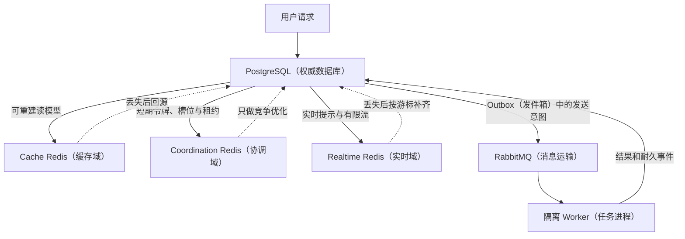

- **PostgreSQL 抽屉**里放 ResumeVersion、InterviewQuestion、Operation、预算账本、Outbox/Inbox 和审计。这些对象要回答“业务是否发生、谁有权推进、最终结果是什么”。
- **Redis 抽屉**只放带 TTL 或可重建的信息。Cache 的值可淘汰；Coordination 的 token/lease 影响是否允许开始昂贵或安全敏感动作；Realtime 的 channel/stream 只加速通知，不能成为唯一事件历史。
- **RabbitMQ 抽屉**放在途消息。消息 Payload 只携带稳定 ID，正文回数据库按权限重载；队列 ready 数量不是业务成功数，Broker DLQ 也不等于数据库 Outbox Dead。

如果一条数据在故障后必须用于法律审计、扣费对账、恢复用户结果或跨租户授权，它就不应该只存在 Redis/MQ。

### 39.3 Cache Aside（旁路缓存）为什么先改库、再删缓存

以“公开岗位详情”缓存为例，正常读流程是：先读 Cache；未命中则读 PostgreSQL，写入带 TTL 的缓存后返回。写流程采用“提交数据库后删除缓存”，让下一次读从权威源重建。

反过来“先删缓存，再更新数据库”会出现一个清晰的并发窗口：

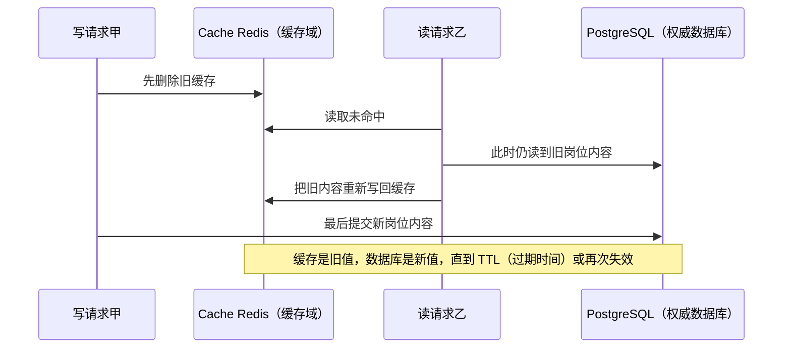

“先更新数据库、再删除缓存”仍有极低概率窗口：一个慢读在数据库更新前读到旧值，却在更新并删缓存后才写入 Cache。其概率较低不是数学上的绝不发生，因此当前 `core/cache_policy.py` 还使用 TTL jitter（过期抖动）、negative cache（空值缓存）、soft TTL（软过期）和 Coordination Single-flight（协调域单飞）降低击穿与陈旧持续时间。若业务要求更强一致，应使用版本化 cache key、事务事件驱动失效或干脆绕过缓存，不能把 Redis 当成第二个权威数据库做复杂双写。

`get_or_load()` 的源码顺序体现这些选择：缓存异常时直接执行 loader 回源；软 TTL 未到返回新鲜值；软过期后尝试用 Coordination Redis 的 owner-token lease 选出一个重建者；其他请求只在有限时间内等待，允许时返回 stale（陈旧但可用）值；leader 再查一次缓存防止重复重建，完成后带随机 TTL 写入。lease 释放用 Lua 比较 owner 后删除，避免甲的租约过期、乙获得新租约后，甲误删乙的锁。

### 39.4 多维限流为什么必须一次 Lua 决策

一次模型请求可能同时受“用户每分钟、企业每分钟、任务类型、模型 Deployment 并发”限制。若应用逐个 Key 扣 token：先扣用户额度，随后企业额度不足而拒绝，请求没有执行却消耗了用户 token；高并发下还会出现多个进程分别看见足额再同时扣减。

`AdmissionController.consume_multi_tokens()` 先把所有维度的 capacity、refill、requested 和 TTL 组成一个 Lua 调用。脚本在 Redis 单线程执行上下文中先计算所有维度能否通过，只有全部允许才一起写回；否则返回第一个 blocked dimension 与 `retry_after_ms`。这保证的是协调层的**原子准入**，不是业务恰好一次。即使 lease 因 Redis 故障丢失，最终结果仍由 PostgreSQL Operation fence 和领域唯一键裁决。

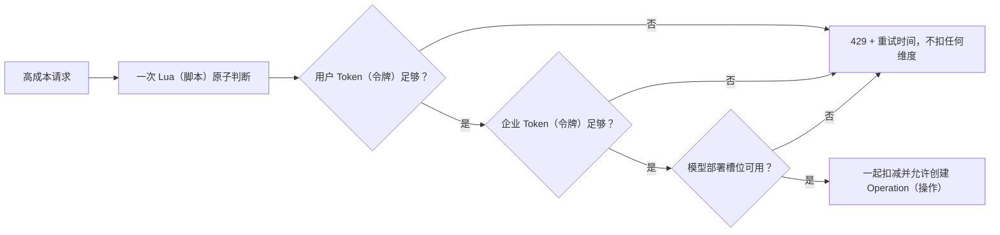

Coordination Redis 不可用时，验证码、MFA、密码恢复和高成本 AI 任务返回结构化 503，而普通只读仍继续。原因不是 Redis 比数据库更“重要”，而是系统此时无法安全判断重放、速率和并发预算；宁可暂时拒绝昂贵/安全操作，也不能无界入队或绕过验证。

### 39.5 RabbitMQ 确认链逐段解释

RabbitMQ 链路至少有三种不同确认，不能统称为“ACK”：

1. `Publisher Confirm（发布确认）`：Broker 接受消息后对 Publisher 确认。它不表示 Consumer 已处理，也不消除 Publisher 在确认后、更新 Outbox 前崩溃造成的重复发送。
2. `Mandatory Routing（强制路由）`：消息无法路由到任何 Queue 时返回 Publisher。它用于把拓扑错误显性化；禁止 `CELERY_TASK_CREATE_MISSING_QUEUES` 静默造一个错误队列。
3. `Consumer ACK（消费者确认）`：Worker 在业务事务完成后确认消息。late ACK 让崩溃前未确认消息可重投，但 Worker 仍可能在提交结果后、发送 ACK 前崩溃，因此处理器必须幂等。

Quorum Queue（仲裁队列）复制日志并提供 leader 故障恢复，但单节点 Compose 只验证声明参数，不提供 HA。`x-delivery-limit` 和按域 DLQ 控制毒消息的无限重投；业务延迟重试不使用两套 Broker TTL 时钟，而由 `OperationDispatchOutbox.available_at` 统一调度。这样 Staff 查询 Operation 时看到的下一尝试时间才是权威事实。

### 39.6 九种依赖故障的确定行为

| 故障 | 用户可见行为 | 权威恢复点 | 绝不能做的事 |
|---|---|---|---|
| Cache Redis 断开 | 普通读取变慢但继续 | PostgreSQL 查询 | 把缓存异常变成整站 500 |
| Cache 热点同时过期 | 一个 leader 重建，其余短等/陈旧读 | Coordination single-flight + TTL | 每个请求同时压数据库 |
| Coordination Redis 断开 | 安全流程/高成本写 503，普通读继续 | 客户端重试；无 Operation 时不伪造 ID | 绕过 MFA、限流或并发槽 |
| Coordination lease 丢失 | 可能多一个执行者 | PostgreSQL fencing token | 声称 Redis 锁保证最终唯一 |
| Realtime Redis 断开 | WebSocket/SSE 加速降级为轮询 | OperationEvent/Chat Message 游标 | 把 token stream 当永久日志 |
| RabbitMQ 断开 | 已入 Outbox 的请求保持 accepted/waiting | Dispatch pending/failed | 返回 completed 或丢掉 Dispatch |
| Broker 重复投递 | 第二 Worker 无法取得活动 claim | Operation lease/fence/终态 | 依赖“消息 ID 大概不会重复” |
| PostgreSQL 断开 | 停止业务写入 | 数据库恢复/PITR | 用 Redis/MQ 记录伪成功 |
| Qdrant/Meili 断开 | 按 policy 关键词/SQL 降级或 required RAG 暂停 | Knowledge revision + Trace | 跨租户全局召回后再过滤 |

### 39.7 验证命令、观察点与未验证项

```powershell
cd ai_interview_backend
python manage.py test core.test_redis_resilience core.test_operations --settings=ai_interview_backend.test_settings --noinput -v 2
python manage.py check
cd ..
docker compose -f docker-compose.yml -f docker-compose.production-resilience.yml config
```

Redis 聚焦测试覆盖 Key Builder 隐藏敏感标识、多维 Lua 一次决策、blocked dimension/retry、owner-check renew/release、非法 RuntimePolicy、可信代理 IP、真实连接上的租约竞争与 WebSocket Ticket 原子消费。Operation 测试覆盖 Publisher Payload、claim/fence、重试、取消、stale recovery 和并发 Worker。Compose config 只能证明声明可以合并；真实验收还要检查每个 Redis 域的 eviction/maxmemory/TLS/ACL、Rabbit exchange/queue/binding 的 passive 等价性、每关键队列 consumer、ready/unacked/redelivery/DLQ，以及 Worker 崩溃注入。

截至本验证基线，Docker daemon 不可用，因此真实 Broker/Redis/Celery、三节点 Quorum、500 并发、PITR 与灾备保持 `pending-verification`。文档中的故障行为是已实现代码契约与待验证运行目标的组合，不能把表格本身当演练结果。

### 39.8 面试追问如何收束

如果面试官问“Redis 和 MQ 都挂了怎么办”，不要回答“做集群”。先按能力拆分：Cache 挂了回源；Coordination 挂了高风险入口 fail closed；Realtime 挂了按数据库游标轮询；Rabbit 挂了 Outbox 等待；PostgreSQL 挂了停止写。再说明副本/托管服务只能降低故障概率，不能替代超时、幂等、fence、回压和恢复演练。最后给出当前证据边界：代码与测试已覆盖协议，真实多节点和容量仍需预发布环境验证。
