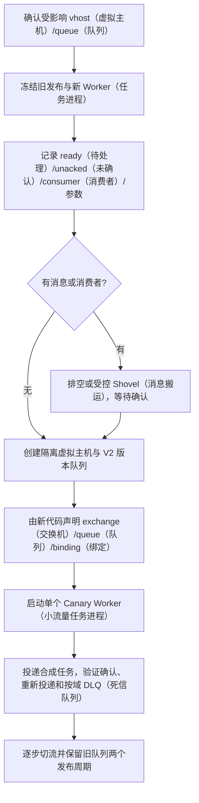
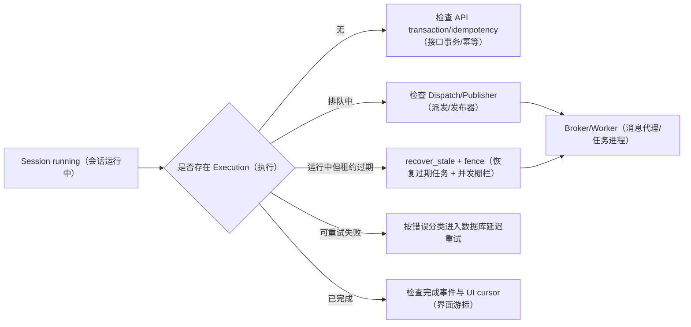
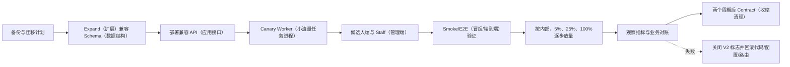

# 运行与故障手册

## 1. 先确认你要启动哪一层

- 只做模型/迁移/API 单测：使用测试 settings 或独立 PostgreSQL，不需要全部基础设施；
- 做普通页面：PostgreSQL + Redis + Django + Candidate/Staff Vue；
- 做异步导入/渲染/Agent：再需要 RabbitMQ + Celery；
- 做完整 RAG：再需要 Qdrant + Meilisearch，embedding 还需 Gateway；
- 做媒体：需要 ClamAV、对象存储/本地媒体配置、FFmpeg；
- 做可观测：LiteLLM/Langfuse/ClickHouse 视配置启动。

所有命令先从仓库根 `E:\AI_interview` 执行只读检查：

```powershell
git status --short
docker compose -f docker-compose.infra.yml ps
Get-NetTCPConnection -State Listen |
  Where-Object LocalPort -in 8000,5173,5174,5433,5672,6379,6380,6381,6333,7700
```

不要在脏工作树执行 reset；不要把 `.env`、数据库 dump、真实 Resume 放入 Vault。

## 2. 仅启动基础设施

```powershell
docker compose -f docker-compose.infra.yml up -d
docker compose -f docker-compose.infra.yml ps
```

默认本地端口：PostgreSQL 5433、Cache Redis 6379、Coordination Redis 6380、Realtime Redis 6381、RabbitMQ 5672/15672、Qdrant 6333/6334、Meilisearch 7700、LiteLLM 4000、ClamAV 3310。三个 Redis 是三个进程，用来验证不同淘汰与降级语义；本地单主机不代表生产高可用。以 Compose 展开结果和本地 env 为准，不把默认开发密码当生产配置。

本地 Qdrant 固定 `qdrant/qdrant:v1.13.6`，Python 使用 `qdrant-client>=1.14,<1.15`；启动后应同时核对 server/client version（服务端/客户端版本）相差不超过一个次版本。升级只重建服务容器并保留命名 volume；不要删除承载 collection 的 volume。

`healthy` 只表示容器 healthcheck。应用 readiness 还要验证：

- PostgreSQL app role 可连接目标 DB；
- Django migration 已应用；
- Cache SET/GET/DEL、Coordination Lua/TTL/write、Realtime XADD/XREAD/EXPIRE 分别可用；
- RabbitMQ 当前代码能等价声明稳定 exchange、`ifaceoff.v2.*` queue/binding，并且每个关键 queue 有消费者；
- Qdrant collection/Meili index schema 匹配；
- Gateway credential/policy 可用或允许降级。

## 3. 数据库迁移

设置 `IFACEOFF_DATABASE_URL` 指向明确的 PostgreSQL 后：

```powershell
Set-Location E:\AI_interview\ai_interview_backend
python manage.py showmigrations
python manage.py migrate --plan
python manage.py migrate --noinput
python manage.py check
```

高风险生产步骤：

1. 记录当前 release/schema；
2. 验证备份可恢复；
3. 检查 migration 是否锁大表/数据回填；
4. expand schema，部署兼容代码；
5. 后台回填和验证；
6. 切流；
7. 下个 release 才 contract。

本轮 `resumes.0008` 修复只影响尚未应用该 migration 的环境。已应用环境不重跑。不要对已应用 production migration 随意修改后假设 Django 会执行。

## 4. 独立文档演示数据库

文档截图使用独立临时数据库，从零 migration，不复用开发主库。命名应包含日期/随机后缀，创建前查询是否存在。清理前再次解析并核对精确数据库名，不对 `postgres`、`ifaceoff_app` 或未知数据库执行 drop。

演示数据：

```powershell
$env:DEBUG='true'
$env:ALLOW_DOCS_DEMO_DATA='1'
$env:IFACEOFF_DOCS_PASSWORD='<process-only>'
$env:IFACEOFF_DOCS_STAFF_PASSWORD='<process-only>'
$env:IFACEOFF_DOCS_TOTP_SECRET='<process-only>'
python manage.py seed_documentation_demo --namespace ifaceoff-docs-v1 --json
```

保护条件：

- DEBUG 必须为 true；
- ALLOW_DOCS_DEMO_DATA 必须为 1；
- 密码/TOTP 只从进程环境；
- namespace 必须安全；
- 重跑不重复；
- `--purge` 只清该 namespace；
- 不调用收费模型，Gateway fixture 禁用且无 secret。

## 5. 启动 Web

首次启动先创建仓库级隔离环境并安装项目直接依赖：

```powershell
Set-Location E:\AI_interview
py -3.12 -m venv .venv
.\.venv\Scripts\python.exe -m pip install --upgrade pip setuptools wheel
.\.venv\Scripts\python.exe -m pip install -r .\ai_interview_backend\requirements.txt
.\.venv\Scripts\python.exe -m pip check
```

不要使用全局 Python 的 `pip freeze` 替代该清单。RenderCV 由容器中的独立环境提供；本机直接运行时，没有 RenderCV 可执行文件只影响真实 PDF/PNG 渲染，不影响 Studio 与其他后端启动。

后端：

```powershell
Set-Location E:\AI_interview\ai_interview_backend
..\.venv\Scripts\python.exe -m uvicorn ai_interview_backend.asgi:application --host 127.0.0.1 --port 8000
```

候选人端：

```powershell
Set-Location E:\AI_interview\ai-interview-frontend
npm run dev -- --host 127.0.0.1 --port 5173
```

Staff 端：

```powershell
Set-Location E:\AI_interview\ai-interview-admin
npm run dev -- --host 127.0.0.1 --port 5174
```

检查 HTTP 200、浏览器 Network、Django server log。API 根 404 不一定是故障；访问明确 health/readiness/业务 endpoint。

候选人端开发配置必须让 `VITE_API_BASE_URL=/api/v1` 走 Vite 同源代理。若登录返回“CSRF cookie not set”，先确认页面与 API 没有混用 `localhost`/`127.0.0.1`，修改环境变量后重启 Vite，并清理旧站点 Cookie 或强制刷新。

## 6. 启动 Celery

### 2026-10-06：项目环境与隔离启动

**Windows 重启陷阱已修复**：PowerShell 7 的 `ConvertFrom-Json` 可能把 ISO 时间直接变成 UTC DateTime（日期时间）。再转为本地字符串并重新 Parse（解析）会丢失时区，错误偏移 8 小时，导致 PID 身份校验跳过旧进程。现在保持 DateTime.Kind（时区属性），字符串使用 RoundtripKind（保留原时区）解析。停止已校验的管理 PID 时终止其进程树，包括虚拟环境 Python 启动器的真实子进程，避免重复消费者和多个 Beat。只处理 PID 登记中身份匹配的进程，不按所有 Python 进程名全局杀进程。

启动日志仍会出现 Celery 原生延迟投递与直连交换机不兼容的提示；它不是当前任务已经阻塞的证据。新 Operation 的业务退避使用数据库 `available_at`，不依赖直连交换机的 ETA（未来执行时间）投递；历史直接 countdown（倒计时）路径仍应逐项迁移，不能把该警告解读成原生延迟已获支持。

```powershell
Set-Location E:\AI_interview
# 自动选择 .venv；celery-worker 是十个隔离进程的兼容别名。
.\scripts\ifaceoff-dev.ps1 -Action up -Components celery-worker,celery-beat
.\scripts\ifaceoff-dev.ps1 -Action status
# 单角色也可配入 PyCharm。
.\.venv\Scripts\python.exe ai_interview_backend\manage.py run_isolated_worker --role media --pool solo --concurrency 1
```

先停止旧共享 Worker 再切换，避免旧消费者继续拿跨领域任务。两个 Celery 批处理入口转发到相同脚本，不再维护旧队列名。显式 `IFACEOFF_PYTHON` 优先于项目环境；排障先查 `sys.executable`，不要用缺依赖系统环境覆盖已安装的 `.venv`。

```powershell
Set-Location E:\AI_interview\ai_interview_backend
..\.venv\Scripts\python.exe manage.py declare_celery_topology --check
..\.venv\Scripts\python.exe manage.py verify_worker_isolation
..\.venv\Scripts\python.exe manage.py audit_legacy_operations
```

合成验证创建随机临时队列和四个测试进程，独立控制交换机，不调用真实业务/模型，结束清理自己的资源。历史三条待处理视频仅审计，不能未经核对自动重跑。FFmpeg 默认 600 秒执行截止、120 秒无进度截止；长期待处理先查消费者，运行中停滞再查租约、进度和外部进程。

回滚保留新增队列、事件和产物，不删有消息队列。已存在的简历智能任务若仍指向旧面试队列，不改写历史输入；旧队列排空后新任务才使用独立队列。真实录制、供应商模型和生产仲裁故障演练仍待验收。

先由受控管理命令声明并校验 V2 拓扑；它不会用“异常即重建”覆盖旧队列：

```powershell
Set-Location E:\AI_interview\ai_interview_backend
python manage.py declare_celery_topology
```

Windows 本地可用 solo pool 做单队列功能验证，必须显式指定队列；不要用一个全队列 Worker 作为隔离证据：

```powershell
Set-Location E:\AI_interview\ai_interview_backend
python -m celery -A ai_interview_backend worker -l info -P solo `
  -Q ifaceoff.v2.publisher,ifaceoff.v2.events,ifaceoff.v2.notifications
```

生产按 Publisher/Recovery、Agent Interactive、Career Analysis、Document/OCR、Resume Render、Media/FFmpeg、Community Moderation、Events、Notification/Search 分 Worker，Beat 保持单副本。Document 与 Media、Publisher 与 Notification 不得重新合并。启动后用同一环境：

```powershell
python -m celery -A ai_interview_backend inspect ping --timeout 5
python -m celery -A ai_interview_backend inspect active --timeout 5
python -m celery -A ai_interview_backend inspect reserved --timeout 5
```

`inspect ping` 只证明至少一个 Worker 存活。发布 readiness 还必须查询 `ifaceoff.v2.agent.interactive`、`career.analysis`、`documents`、`resume.render`、`media`、`community.moderation`、`events`、`notifications`、`search.index`、`publisher` 的 ready/unacked/consumer/oldest age，并检查 Dispatch/Integration Outbox 最老 pending age。

## 7. RabbitMQ 406：队列声明不兼容

### 症状

Worker 日志：

`PRECONDITION_FAILED - inequivalent arg 'x-dead-letter-exchange' for queue 'celery' ... current is none`

### 原因

旧队列用相同名字创建但没有当前 DLX。RabbitMQ 不允许客户端热改 durable queue 声明参数，以防两个消费者对队列语义理解不同。代码现已使用 `ifaceoff.v2.*` 队列规避同名覆盖，但真实环境仍要完成旧队列盘点、排空与回滚窗口。

### 只读诊断

```powershell
docker exec Ifaceoff-infra-rabbitmq rabbitmqctl list_queues `
  name durable arguments messages_ready messages_unacknowledged consumers
docker exec Ifaceoff-infra-rabbitmq rabbitmqctl list_exchanges name type durable
docker exec Ifaceoff-infra-rabbitmq rabbitmqctl list_bindings
```

### 安全处置



观察重点：没有先执行 delete；删除是经过消息与消费者核验、业务幂等、canary 和回滚窗口后的最后一步。本轮业务延迟重试由 PostgreSQL `OperationDispatchOutbox.available_at` 调度，不存在应被运维依赖的 Rabbit TTL Retry Queue。

数据库 `OperationDispatchOutbox/IntegrationOutbox.status=dead` 与 RabbitMQ Broker DLQ 是两类不同对象。管理端现已补入已有耐久协议任务的 Broker 查看、试运行和受控重放，最多100条，原来源校验、发布确认与逐条审计先于原死信确认；未知旧任务保留。生产集群和真实 Cookie/浏览器全链仍为 pending-verification（待验证），不得把数据库状态重置称为 Broker 重放。

面试时如何讲：Compose healthy 与 Worker readiness 分开；同名队列参数不能热变。

## 8. 运行截图

截图测试需要 fixture 返回的 Resume/Interview ID 和当前 Staff TOTP code。只把变量名写入脚本/文档，不保存值。

```powershell
$env:IFACEOFF_E2E_BASE_URL='http://127.0.0.1:5173'
$env:IFACEOFF_DOCS_ADMIN_URL='http://127.0.0.1:5174'
$env:IFACEOFF_DOCS_SCREENSHOT_DIR='<temporary-vault>\assets\screenshots'
$env:IFACEOFF_DOCS_VIRTUAL_MEDIA='1'
$env:IFACEOFF_DOCS_EMAIL='<synthetic>'
$env:IFACEOFF_DOCS_PASSWORD='<process-only>'
$env:IFACEOFF_DOCS_STAFF_EMAIL='<synthetic>'
$env:IFACEOFF_DOCS_STAFF_PASSWORD='<process-only>'
$env:IFACEOFF_DOCS_STAFF_MFA_CODE='<current-code>'
$env:IFACEOFF_DOCS_RESUME_ID='<seed-id>'
$env:IFACEOFF_DOCS_ACTIVE_INTERVIEW_ID='<seed-id>'
$env:IFACEOFF_DOCS_COMPLETED_INTERVIEW_ID='<seed-id>'
npx playwright test tests/e2e/documentation-screenshots.spec.ts
```

`IFACEOFF_DOCS_VIRTUAL_MEDIA=1` 只在文档测试时给 Edge 增加 fake media 参数。截图后校验 1440×900、文件数、SHA-256 和隐私。

## 9. Resume 页面显示 0 份

### 诊断

1. 查看 Network 最终 URL；
2. 查看 Django 日志；
3. 查询当前用户 Resume；
4. 对比 URLConf；
5. 检查 Axios base。

本轮最终 URL 是 `/api/v1/api/v2/resumes/`，Django 404，而数据库有 Resume。修复方向是统一 host base 或独立 v2 client；不要再 seed。

修复后回归：

- 列表显示稳定 fixture title；
- Studio detail/draft/version/template/quality/share/suggestion/avatar 请求全部 `/api/v2/...`；
- 401/404/503 不变空数组；
- Candidate build + Playwright；
- 更新卷二/卷三与变更日志。

## 10. Staff Agent Config 白屏

复现 `/agent-config`，抓 console error、Network 与 Vue error handler。对照 `AgentConfig.vue` 的 setup 依赖、API schema 和条件渲染。先加 error boundary/明确错误态，再修数据契约。空白 PNG 只作为缺陷证据，不计功能成功。

## 11. Agent Execution 卡住

查询顺序：

1. Session 业务状态；
2. AgentRun/Execution status、updated/heartbeat、attempt/fence；
3. Dispatch status、celery task id、error/next attempt；
4. RabbitMQ queue depth/consumer；
5. Worker log；
6. checkpoint thread；
7. NodeRun/Trace；
8. last durable event sequence。



不要直接手改 Session finished 或复制问题。恢复必须通过 Execution/Dispatch 协议。

## 12. SSE 断线

- 客户端保存 last event id；
- 重连带 cursor；
- 服务端校验 owner 和 run；
- 从 durable/stream 读取 `sequence > cursor`；
- 若超出保留，返回 state.snapshot；
- 最终 completed 后回读 Question/Execution。

若 Redis realtime 丢失，但数据库已完成，页面可通过 snapshot/轮询恢复，不重新调用模型。

## 13. RAG 无结果

按顺序检查：

1. Document visibility/approval/current revision；
2. published Chunk count；
3. AgentConfigKnowledgeBinding scope/revision/required；
4. Qdrant collection alias/vector size/payload filter；
5. Meili index/task/filter attributes；
6. tenant user；
7. query plan/multi query；
8. trace 中 candidate_filter_reason；
9. token budget 是否截断；
10. required/optional fallback。

若日志出现 `QdrantClient object has no attribute search`，说明代码与新 SDK 接口漂移：当前实现必须使用 `query_points(query=...).points`。若出现版本差异告警，执行 `pip check`、读取 Qdrant `/` 版本，并对照本手册的 1.13.6/1.14.x 组合；不要通过关闭兼容检查掩盖问题。若 `get_collections()` 为空，先发布并索引合成测试文档，再验证带 tenant/approval/revision filter（租户/审批/修订过滤）的查询。

不要为了“有结果”去掉租户过滤或把未审批文档设公开。

## 14. 索引重建

从 PostgreSQL 固定 source revision，建新物理索引，分批写入，核对 count/hash/抽样查询/tenant，切 alias/active，再延迟清旧。重建期间旧活动索引继续读。

Meili 若当前版本不支持所需原子 alias，使用版本化 index name + 应用配置切换，明确短窗口和回滚。

## 15. Gateway 故障

检查 Alias → Policy → Target → Deployment → Credential active；Budget reservation；Ledger/Attempt error；LiteLLM/provider health；timeout/retry 层。认证/预算错误不重试；429/5xx按 policy；结构错误记录 Attempt。

降级：

- rule-only evaluation；
- RRF 无 reranker；
- keyword/SQL fallback；
- 非关键文案稍后重试。

严禁业务代码绕过 Gateway 读取某个环境 API key。

## 16. 数据库备份恢复

恢复验证不是 `pg_restore` 退出码。至少检查：

- migration 一致；
- 用户/权限/关键表数量；
- 外键/唯一约束；
- Resume current version/draft/artifact；
- Session/Execution/Dispatch；
- Outbox/Inbox；
- Knowledge revision/chunk；
- Staff audit hash；
- sequence；
- 随机业务读。

索引/对象按 key/hash 对账。恢复环境隔离外部 webhook/邮件/模型，避免重放副作用。

## 17. 发布与回滚

Broker 重放代码是增量接口，没有迁移或队列删除。上线前先验证专属环境，再为运维角色授予 `platform_events.replay`；只读角色不授予该权限。出现问题时撤回重放权限或回滚接口/页面，保留原 DLQ、数据库审计和幂等记录，不清空消息。确认重放不等于重启业务状态机；终态 Operation（操作）必须单独审核重试。



数据库与消息采用 expand–backfill–switch–retain（扩展—回填—切换—保留）。新建请求按领域 Feature Flag 进入 V2 Operation Dispatch，运行中的旧任务保持旧路径；禁止双执行外部任务。回滚只关闭 V2 domain flag 并切回兼容适配器，不删除 Operation、Dispatch、Event、新队列或历史结果。回滚不仅是 Git：还要回滚 Prompt revision、Gateway Policy、FeatureFlag、索引 alias 和 queue routing。已写新 schema 数据时旧代码是否能读必须提前验证。

## 18. 事故响应

等级按数据泄漏、认证越权、面试中断、模型成本、异步积压和普通页面错误划分。共同步骤：

1. 记录时间、影响、request/run/ledger id；
2. 止损：flag/限流/停 Worker/撤密钥；
3. 保存日志/队列/审计证据；
4. 修复/恢复并验证；
5. 通知受影响方；
6. 根因与故障窗口；
7. 行动项含 owner/date/test；
8. 更新对应卷和变更日志。

不要在事故中删除失败记录来“清干净”，应保留可审计状态并按保留政策处理。

## 19. 停止临时环境

停止本轮启动的 Django/Vite/Worker 时按端口和启动时间确认 PID，只停止明确进程。临时 PostgreSQL DB/vhost 的删除属于破坏操作：先确认没有连接/消息、名称精确匹配文档 namespace，再执行；不删除共享 Compose volume。

## 20. 发布验收清单

2026-10-07 简历重复基线命令 `./.venv/Scripts/python.exe scripts/run_deterministic_evaluation.py --browser-platform --repeat 3`：21/21通过，主库核验通过，保存/权威预览/实际JSON、DOCX、PDF下载均计端到端时间。3样本低分位数报告不作为容量验收；预览约4.12秒仍有优化空间。社区样式只替换`CommunityHub.vue`及话题只读客户端，不迁移业务表，原`BlogHome.vue`与路由不变。回滚该视觉改动只恢复组件与新增客户端封装，不能丢弃工作区其他可靠性改动或回退内容审核模型。

### 管理端真实 Broker 死信验收

统一入口：

```powershell
./.venv/Scripts/python.exe scripts/run_deterministic_evaluation.py --groups broker_admin
./.venv/Scripts/python.exe scripts/run_deterministic_evaluation.py --broker-admin-real
```

第二条创建带本次标签的临时 PostgreSQL 16/RabbitMQ 3.13 容器，使用合成管理账号与消息，经真实管理 API 验证试运行保留、未知任务隔离、强制路由不可达、发布拒绝保留、确认后审计/确认原死信、幂等响应和权限。结束只清理本次拥有的容器，不访问开发/生产队列。单节点版本只是本机现有测试镜像，不替代 RabbitMQ 4.3 多节点 HA（高可用）验收。

运维顺序：打开管理端 `/operations/events` → 选择已配置 DLQ（死信队列）→ 读取深度 → 试运行并填写原因 → 检查保留原因 → 修复依赖与业务任务状态 → 再次试运行 → 确认重放。部分成功时先读审计，不直接连点下一批；未收到响应使用原幂等键重试。原交换机无绑定或目标队列满时，不应看到原死信消失。未知任务不允许靠改请求字段绕过白名单。

若返回 `409 broker_replay_outcome_uncertain`（批次结果待核对），该键不会继续消费。检查 `broker_dlq.replay_started/publish_confirmed/replay_finished/replay_failed` 审计、ready/unacked（待处理/未确认）和业务 Operation 状态，核对后重新试运行并用新键开始新批；不要求管理员删审计或删幂等记录来“解锁”。

#### 固定到达率与写入 TPS（每秒成功事务数）

创建剖析现额外执行5次回滚POST（写请求），只使用本轮合成账号，确认简历数没有增加。`application_profile`（应用内剖析）区分SQL次数/耗时与应用时间；它不含提交耗时或真实服务排队。主库真实HTTP写入仍最多40次。优化后首轮p95约411ms，下一轮需重复观察，不能用回滚剖析时间替代接口p95。

只补测Broker DLQ（死信队列）协议可执行：

当前完整运行证据为`operation-faults-20261007T052251Z.json`，11项通过；独立DLQ运行为051921报告，3项通过。查看scope（范围）区分协议实验与管理端能力，不把`partial`（范围有限）误读成所有测试失败或全生产验收。

```powershell
./.venv/Scripts/python.exe scripts/run_deterministic_evaluation.py --broker-dlq
```

`--operation-faults`也包含该组。实验只操作本次标签容器和合成消息，重发NACK（发布拒绝）后保持原死信；仅确认成功才消费确认。管理端 API 的专属验收另见 `--broker-admin-real`，数据库 Outbox 重放仍不是 Broker 重放。失败时保留报告、检查实际消息计数与发布确认，禁止以删除队列清空错误。

后续对照入口（只停止本次创建的临时API进程，不重启8000服务；数据库与缓存复用开发环境）：

最终参考报告 `authenticated-http-20261007T050637Z.json`：10秒/路由读取1600/1600，模板/列表p95约247/107ms，写入40/40但p95约598ms不达500ms。运行后同时检查 `performance_checks`（性能门禁）与功能状态，不能只看HTTP 200/201。与此前5秒样本相比，读取窗口更长但仍不是长稳；写入仍被40次安全上限截断，不称持续TPS。

```powershell
./.venv/Scripts/python.exe scripts/run_deterministic_evaluation.py --authenticated-http --http-users 16 --http-concurrency 64 --http-duration 5 --http-arrival-rate 80 --http-isolated-server asgi
./.venv/Scripts/python.exe scripts/run_deterministic_evaluation.py --authenticated-http --http-users 16 --http-concurrency 64 --http-duration 5 --http-arrival-rate 80 --http-isolated-server asgi-pooled --http-writes
```

先看 `schedule_lag_ms`（施压调度延迟）、`executor_wait_ms`（客户端线程等待）和计划完成率，再解释服务端分位数。工具已消除Windows逐请求证书上下文构造；早期失速结果仅作问题定位，不能作后端容量结论。专属进程在Windows按自己保存的PID停止整棵进程树，避免虚拟环境启动器结束但子解释器持有日志；禁止批量结束所有Python。050339实测写入40次成功但p95=568.908ms，超过500ms目标；8项异步故障通过不代表生产灾备或所有业务。

当前参考证据：`authenticated-http-20261007T044538Z.json` 为20次/秒低负载成功；`authenticated-http-20261007T045144Z.json` 的80次/秒因客户端背压约50%而 `partial`，不能称生产容量已达标；`operation-faults-20261007T045214Z.json` 中7个故障场景通过且校验重投消费完成回执。评估结束后检查无 `ifaceoff-eval-*` 本次拥有的容器；若中断留下资源，仅在确认所有权标签与本次前缀相等后清理，禁止批量删除应用容器。

先启动本地 API（接口服务），再执行：

```powershell
./.venv/Scripts/python.exe scripts/run_deterministic_evaluation.py --authenticated-http --http-users 8 --http-concurrency 8 --http-duration 5 --http-arrival-rate 20 --http-writes
./.venv/Scripts/python.exe scripts/run_deterministic_evaluation.py --operation-faults
```

第一条生成新合成用户，临时短期凭据仅允许回环地址、不跟随跳转，最多创建40份简历并核对数据库；合成业务数据保留用于定位。第二条无需停止现有服务，Docker（容器运行环境）必须可用且本地已有 PostgreSQL 16/RabbitMQ 3.13 镜像；只销毁带本次所有权标签的容器和临时媒体。不要在生产运行写入压测。查看 `output/evaluation/authenticated-http-*.json` 与 `operation-faults-*.json`：先看状态、执行用例、数据库核验及客户端丢弃，再看分位数。20次/秒不是最大容量；单次运行、单节点和 JSON 导出不能作为生产 HA（高可用）证据。

认证读接口量化入口：

```powershell
./.venv/Scripts/python.exe scripts/run_deterministic_evaluation.py --authenticated-http --http-users 8 --http-concurrency 8 --http-duration 5
```

先启动本地 API（接口服务）。命令仅给新建合成用户签发五分钟 JWT（身份令牌），报告写 `output/evaluation/authenticated-http-时间戳.json`，不记录令牌；临时文件自动清理，合成账号和简历保留用于追溯。令牌不得发往非回环地址，不通过代理或重定向。模板数量和简历归属校验未通过时，即使 HTTP（网络接口）200 也计失败。没有真实登录供应商或业务写入，TPS（事务率）仍不适用。

浏览器导出测量在菜单点击前把 Studio 置于前台，避免新下载标签使原页面后台动画节流。分段数据保存在浏览器各行的 `stage_timings_ms`（阶段耗时），不是线上观测埋点。历史约 8 秒结果保留，并标注存在菜单选择等待开销。

2026-10-07 可重复首要问题评估：

```powershell
./scripts/ifaceoff-dev.ps1 -Action up -Components django,vite,celery-publisher,celery-resume-render,celery-beat
# 登录恢复→保存→权威预览→JSON/DOCX/PDF 下载，独立合成账号重复三轮
./.venv/Scripts/python.exe scripts/run_deterministic_evaluation.py --browser-platform --repeat 3
# 分路由只读测量，受保护接口须另备合成用户授权
./.venv/Scripts/python.exe scripts/run_deterministic_evaluation.py --groups api_measurement --http-benchmark --http-url http://127.0.0.1:8000/api/v1/auth/csrf/
./.venv/Scripts/python.exe scripts/run_deterministic_evaluation.py --real-infra --groups platform,api_measurement
# 六模板中英文和 A4/Letter 实际渲染，要求本地 rendercv 可执行文件在 PATH
./.venv/Scripts/python.exe scripts/run_deterministic_evaluation.py --groups render_matrix
```

浏览器与同 IP 限流压测按顺序运行，避免匿名配额干扰。报告位于 `output/evaluation/`、`output/playwright/`；凭据临时文件清理，合成记录保留用于追溯。故障实验只停止专属容器，不停止应用实例；单节点恢复时间不称为生产 RTO（恢复时间目标）。

### 非 AI 功能评估的一键入口

真实模式命令（先运行本地应用，浏览器模式需要 Chrome、Git Bash、npx 和 Playwright CLI；基础设施模式需要 Docker daemon（容器服务）及本机已有镜像，不自动拉取镜像）：

```powershell
# 真实 PostgreSQL 状态机/行锁 + 隔离 Redis/RabbitMQ 故障恢复
& '.\.venv\Scripts\python.exe' scripts/run_deterministic_evaluation.py --real-infra --groups operation,worker_contract
# 真实 Studio 保存、刷新登录恢复、合成录像上传与数据库/文件验证
& '.\.venv\Scripts\python.exe' scripts/run_deterministic_evaluation.py --browser
```

两个开关可以组合；任一阶段失败退出非零。浏览器结果在 `output/playwright/live-browser-result.json`，并保存带时间的独立 JSON；凭据与生成脚本不是报告，结束时删除。真实基础设施结果在 `output/evaluation/real-infra-*.json`，PostgreSQL 逐例结果在同目录时间子目录。暂时固定镜像 `postgres:16-alpine`、`redis:7-alpine`、`rabbitmq:3.13-management-alpine`，仅用于本地协议验收，不宣称生产 HA（高可用）。动态宿主端口在重启后重新读取，避免测试工具对旧端口等待造成假故障。

从仓库根目录使用项目虚拟环境（不依赖系统 Python）：

```powershell
& '.\.venv\Scripts\python.exe' scripts/run_deterministic_evaluation.py --media
# 同样的输入重复三轮；每项接口每轮采样 50 次，不是 50 并发。
& '.\.venv\Scripts\python.exe' scripts/run_deterministic_evaluation.py --repeat 3 --samples 50 --media
# 全部非面试、非 AI/RAG 的确定性业务模块
& '.\.venv\Scripts\python.exe' scripts/run_deterministic_evaluation.py --groups platform --repeat 2
# 只重测确定性接口及简历：
& '.\.venv\Scripts\python.exe' scripts/run_deterministic_evaluation.py --groups api_measurement,resume
# 本地只读健康端点的真实 HTTP QPS/p95/p99；显式保留本地和闭环负载边界
& '.\.venv\Scripts\python.exe' scripts/run_deterministic_evaluation.py --groups platform --http-benchmark
# 真实浏览器只测新标签 Cookie 恢复和 Studio 连续编辑自动保存
& '.\.venv\Scripts\python.exe' scripts/run_deterministic_evaluation.py --browser-platform
```

无需启动前端、开发数据库、Redis 或 RabbitMQ；临时数据库隔离于开发数据，每轮重新迁移，首次运行可能较慢。输出在 `output/evaluation/<UTC时间>/`，包含 `report.md`、`report.json`、逐轮结果与日志。JSON 保留基线 Commit（代码提交）、工作区有无已跟踪修改、Python 版本、测试 ID、状态、用例耗时与接口采样；时间目录避免覆盖上次报告。不得将这些合成测试结果描述为生产 SLA（服务协议）。

`--timeout` 限制每轮后端执行时间（默认 600 秒）；`--repeat` 为 1–20，`--samples` 为 1–200。通过率只使用已执行的通过/失败/错误，不把跳过计入成功。总体 `partial`（部分验证）不表示整个平台达标；`failed`（失败）或非零退出须查看日志。FFmpeg 不在 PATH（命令路径）时媒体部分待验证。浏览器自动保存、登录恢复、完整录像上传、PostgreSQL 并发与真实 MQ/Redis 需要显式选择真实模式，不能被默认契约测试代替。

- Django `check` 与 `makemigrations --check --dry-run`；
- Django 全量发现 304 项：302 项通过、2 项外部 PostgreSQL Checkpoint 测试显式跳过；
- Candidate/Admin 两个 Vue production build；
- base、infra、production-resilience、observability 四组 Compose config；
- API/OpenAPI facts；
- 真实 Broker 拓扑、每关键 queue consumer、Mandatory unroutable、Confirm NACK/timeout；
- Worker 重复投递、崩溃、lease/fence、Agent Checkpoint/recovery；
- RAG query/index lag；
- Gateway budget/ledger；
- Playwright；
- secret/privacy scan；
- backup restore evidence；
- 文档 sync/links/facts/changelog。

截至 2026-08-21，静态检查、聚焦 Django 测试、Candidate 构建和 Compose config 已通过；本地 Docker daemon 已恢复，单节点 PostgreSQL、Redis、RabbitMQ、Qdrant 1.13.6、Meilisearch、LiteLLM、ClamAV，以及合并开发 Worker/Beat/Django/Agent/Candidate/Staff 均已实际启动。该证据只验证本地单节点语义；三节点 Quorum、生产 TLS/ACL、完整 DLQ 演练、外部 PostgreSQL Checkpoint、500 用户压测、备份恢复与灾备仍是发布阻断项，状态为 `pending-verification（待验证）`。
